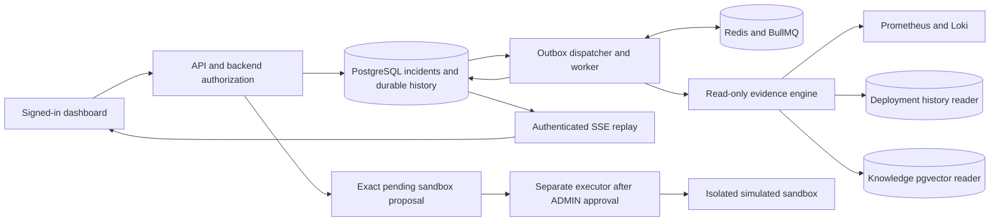

# Sentinel

Sentinel is a learning-first incident response project: investigate with saved
evidence, show uncertainty, and keep write actions under human authorization.
Payments and rollback targets are simulated. Operational records and local
telemetry are real development data.

**Implementation status:** P1–P9 and P10.1–P10.6 are implemented, with verification
scope recorded in [PROGRESS](docs/PROGRESS.md). Public deployment, live chat-model
quality and learner exercises remain separate, unfinished work. P10.6 changes
project documentation; it adds no runtime behavior or database schema.

## Start here

- [Complete end-to-end walkthrough](docs/DEMO-WALKTHROUGH.md): exact terminals,
  startup, sign-in, traffic, incidents, investigations, evidence, live updates,
  separate sandbox approval, shutdown and troubleshooting.
- [Architecture and trust boundaries](docs/ARCHITECTURE.md).
- [Architecture decision records](docs/adr/README.md): choices and tradeoffs.
- [Manual setup](docs/MANUAL-SETUP.md) and [deferred hosted setup](docs/HOSTED-SETUP.md).
- [Evidence-backed portfolio wording](docs/PORTFOLIO.md).

## Run locally — Windows PowerShell

Prerequisites: Git, Node 24/npm 11, Python 3.11 and Docker Desktop running Linux
containers. Start from the existing repository; retain ignored config and volumes.

```powershell
Set-Location 'V:\sentinel\sentinel'
.venv\Scripts\python.exe scripts/demo.py doctor
```

If the stack is already ready, open [the dashboard](http://localhost:3000/dashboard/).
Otherwise, after confirming native/collector ports are free, start it:

```powershell
.venv\Scripts\python.exe scripts/demo.py start --skip-install
```

Use `start` without `--skip-install` when locked dependencies need installing in
`.venv`. For a fresh clone create that environment with `py -3.11 -m venv .venv`.
The [startup guide](docs/P10-DEMO.md) explains fresh Windows/Linux setup, occupied
ports, collector restart and retained data. Do not run another API/observability
supervisor on these same ports. Leave the launcher terminal open.

Sign in with your existing account. There is no default account. Only if you need a
new local account, in a second terminal run the following and enter its password
at the hidden prompts; replace YOUR_EMAIL locally:

```powershell
.venv\Scripts\python.exe scripts/api-user.py create --email YOUR_EMAIL --role ADMIN
```

ADMIN can approve sandbox actions. Grant that role deliberately. No credential
belongs in browser URLs, Git or chat. A browser refresh requires sign-in again.

## Architecture



Tempo stores exported traces separately; the implemented investigation tools query
metrics, logs and deployment history, not arbitrary trace retrieval. The engine has
read-only source credentials. The API/browser/AI do not receive a Docker socket.

## Working features

| Area                     | Implemented behavior                                                                                                     |
| ------------------------ | ------------------------------------------------------------------------------------------------------------------------ |
| Simulated commerce       | Checkout/payment validation, request correlation, optional PostgreSQL idempotency, fixed fault profiles                  |
| Resilience               | Bounded deadlines/retries, concurrency admission and circuit breaker; raw-fault training explicitly disables the breaker |
| Incident management      | Authenticated service list, incident creation/filtering/pagination, validated transitions, saved history                 |
| Identity                 | Password hashing, expiring signed tokens, live user/role checks; VIEWER, OPERATOR and ADMIN                              |
| Telemetry                | Prometheus metrics, Alloy/Loki logs, Tempo trace export, authenticated grouped alert ingestion                           |
| Investigations           | Durable outbox/BullMQ delivery, bounded parallel read tools, immutable evidence/report storage                           |
| Hypotheses               | Default deterministic, cited ranked suggestions; optional local model adapter with validation                            |
| Knowledge                | Verified local embeddings, pgvector retrieval and exact source/version/range/hash citations                              |
| Live dashboard           | React service/incident workspace, saved evidence/report inspection, authenticated replayable SSE                         |
| Human-controlled actions | Exact expiring proposals, ADMIN decision, separate allowlisted sandbox executor and measured recovery audit              |
| Delivery checks          | Windows/Linux fast checks, security scanning, isolated database/queue/knowledge/sandbox/browser CI                       |

The [walkthrough](docs/DEMO-WALKTHROUGH.md) explains each feature's inputs, visible
outputs and failure cases. The default launcher does not inject faults, prepare a
sandbox, start an executor or enable a chat model.

## Measured evidence and limitations

In the recorded nine-trial local experiment, six of six injected dependency faults
were detected, with median detection delay **21.047 seconds** (15.032–24.656, n=6).
There were zero incident-producing healthy controls out of three. These were two
fault types in one local environment; the test-only processor was not BullMQ and
knowledge/chat inference was disabled. All metric comparisons were PARTIAL.
See the full [protocol and results](docs/P10-EVALUATION.md).

A separate ten-case synthetic evaluation had top-1 accuracy 6/7 among labelled
causes and top-2 7/7, with a documented false deployment attribution. These are
separate populations, not production AI accuracy. Default reports say
`ai_performed: false`. A citation establishes provenance, not causation.

Public hosting is unperformed. Local knowledge can exceed its unchanged eight-second
retrieval deadline and become UNAVAILABLE. Sandbox VERIFIED proves only its measured
identity/recovery checks; it does not resolve an incident or establish its root cause.
SQL audit immutability does not defend against a privileged schema owner. Full
hosted tenancy, capacity/SLO claims and production remediation are not established.

## Verify

```powershell
.venv\Scripts\python.exe scripts/check.py fast
.venv\Scripts\python.exe scripts/security_scan.py
```

Fast includes formatting, lint, builds and unit/component checks; it excludes real
DB tests explicitly. The secret scanner checks repository source and reachable
history, not your ignored local secrets. With the separately documented dependencies
and training images ready, integration is available:

```powershell
.venv\Scripts\python.exe scripts/check.py integration
```

Integration includes an actual simulated sandbox rollback. Read the prerequisites
and stop a manual sandbox executor before verifier use. Never run the CI-only
bootstrap on your development machine. Inspect [GitHub Actions](https://github.com/vikramadityasaipulapa-1975/sentinel/actions)
and [PROGRESS](docs/PROGRESS.md) for exact commits/results; historical green CI is
not a claim that your machine is running now.

## Learn and deliver

[P1](docs/P1-LEARNING-GUIDE.md) · [P2](docs/P2-LEARNING-GUIDE.md) ·
[P3](docs/P3-LEARNING-GUIDE.md) · [P4](docs/P4-LEARNING-GUIDE.md) ·
[P5](docs/P5-LEARNING-GUIDE.md) · [P6](docs/P6-LEARNING-GUIDE.md) ·
[P7](docs/P7-LEARNING-GUIDE.md) · [P8](docs/P8-LEARNING-GUIDE.md) ·
[P9](docs/P9-LEARNING-GUIDE.md) · [P10](docs/P10-LEARNING-GUIDE.md).

The [agent contract](AGENTS.md) and [master plan](SENTINEL_CODEX_MASTER_PLAN.md)
preserve task approvals and learning checkpoints. No manual setup is required just
to read P10.6 documentation. Public use still requires separately reviewed hosted
PostgreSQL/pgvector, Redis, backend, worker, evidence service, private telemetry,
secrets, migrations, account bootstrap, HTTPS/SSE and backup/recovery setup.
