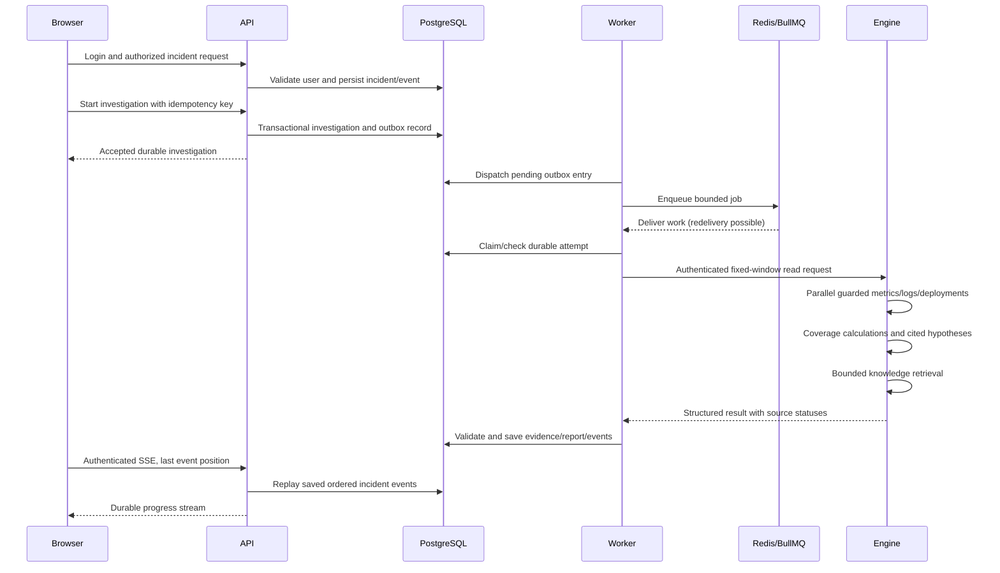
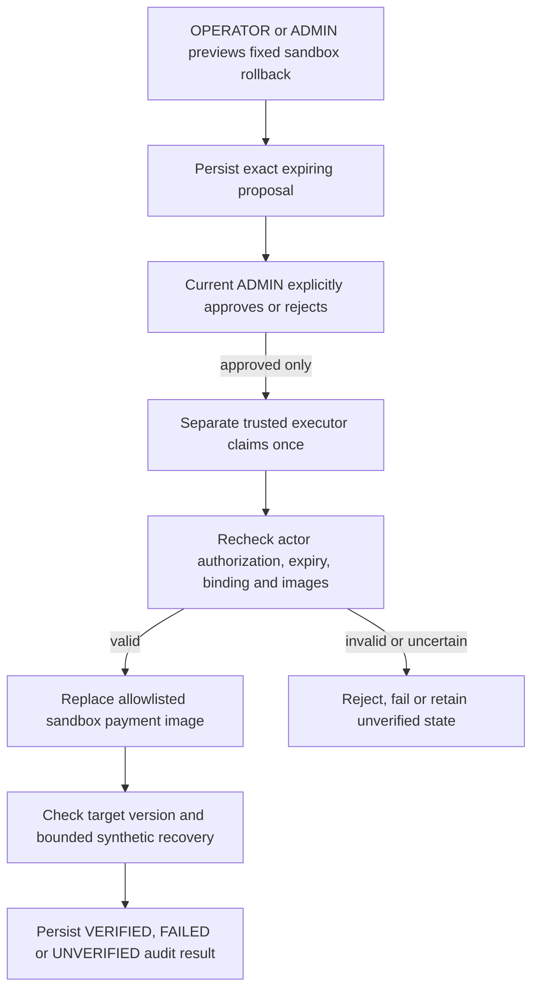

# Sentinel architecture

This describes the checked-in implementation, not a deployed public system.
Read [the runnable walkthrough](DEMO-WALKTHROUGH.md) first for operator commands.

## Components and boundaries

| Component                     | Local endpoint/storage               | Responsibility and authority                                                          |
| ----------------------------- | ------------------------------------ | ------------------------------------------------------------------------------------- |
| Built React dashboard         | API `/dashboard/`, port 3000         | In-memory login session; authorized views and explicit submissions                    |
| Express API                   | 127.0.0.1:3000                       | Validates/authenticates, writes application records, serves dashboard/SSE             |
| API PostgreSQL                | Loopback 55434, `sentinel_api`       | Users, services, incidents, events, jobs/outbox, evidence/reports, proposals/audit    |
| Redis/BullMQ                  | Loopback 56379                       | Job delivery coordination; not the sole durable record of investigation state         |
| Worker/dispatcher             | Native background process            | Dispatches outbox jobs, claims work, collects and persists validated results          |
| Evidence engine               | 127.0.0.1:8001                       | Internal authenticated bounded reads/calculations; no remediation authority           |
| Demo deployment PostgreSQL    | Loopback 55432, `sentinel`           | Simulated payment persistence/version/deployment history; separate SELECT-only reader |
| Knowledge PostgreSQL/pgvector | Loopback 55436, `sentinel_knowledge` | Reviewed document/chunk embeddings; separate SELECT-only runtime reader               |
| Checkout/payment              | 127.0.0.1:3001/3002                  | Simulated traffic, JSON logs, metrics and trace export                                |
| Prometheus                    | Loopback 9090                        | Scrapes bounded-label request metrics and evaluates alerts                            |
| Alloy/Loki                    | Loki loopback 3100                   | Tails owned JSON logs and provides bounded log queries                                |
| Tempo                         | Loopback 3200; OTLP HTTP 4418        | Stores exported traces; no implemented engine trace-search tool                       |
| Alertmanager                  | Loopback 9093                        | Groups firing/resolved alerts and calls a bearer-authenticated API webhook            |
| Sandbox checkout/payment      | Loopback 4301/4302                   | Separate memory-only fault/recovery target                                            |
| Sandbox executor              | Explicit trusted CLI process         | Revalidates approved action and changes only allowlisted sandbox runtime              |

`demo.py` owns native processes directly and retains dependency containers/data.
It uses memory-only simulated payments, while application/knowledge/deployment
records live in development PostgreSQL. The older full P2 Compose mode persists
simulated payments in PostgreSQL. Do not start both modes on ports 3001/3002.

## Request and investigation flow

An accepted request is not a completed investigation. Async HTTP/subprocess work is
bounded; the graph overlaps source reads and joins before analysis. A failed source
can leave useful partial evidence. Reports, snapshots and citations are validated by
the backend before persistence. Queue delivery can repeat: durable identity/claims,
leases and idempotency prevent treating redelivery as permission for duplicate work.
This is not a universal exactly-once-execution guarantee.

PostgreSQL holds crash-recoverable workflow state; the LangGraph object does not
provide a persistent workflow checkpoint. See [ADR 001](adr/001-durable-jobs-and-sse.md)
and [ADR 002](adr/002-bounded-evidence-and-hypotheses.md).

## Evidence, ranking and retrieval

Prometheus, Loki and deployment records feed fixed, validated tools. Time ranges,
service selection, returned sizes, parallelism and deadlines are bounded. The engine
compares coverage before claiming before/after changes. PARTIAL/EMPTY/UNAVAILABLE
are information, not errors to hide. Tempo export is a separate observability path.

Default ranking is deterministic and explicitly reports no chat-model inference.
The optional local model adapter receives untrusted evidence, returns schema-bound
suggestions and cannot introduce arbitrary commands. Local CPU embeddings retrieve
up to three reviewed passages from pgvector; backend validation binds document,
version, section, character range and hashes. Saved reports do not change when a
runbook or live metric changes. See [ADR 003](adr/003-local-knowledge-and-provenance.md).

## Approval and action flow

The API has no Docker socket and does not start the privileged executor. Native
processes under one Windows account are not OS-level permission isolation. Exact
container/image/project bindings and action-state guards narrow the demo capability;
a privileged host/database operator can still bypass application controls. No AI,
retrieved passage, incident text or telemetry item can authorize execution.
VERIFIED applies only to that sandbox's measured checks. The main incident remains
under human control. See [ADR 004](adr/004-human-approved-sandbox.md).

## Authentication, storage and failure handling

- Password hashes are salted; signed access tokens expire and are checked against
  current account state. VIEWER reads, OPERATOR adds incident/investigation/proposal
  work, ADMIN additionally decides proposals. Backend rules apply independently of UI.
- Browser tokens remain in memory. Refresh/logout forgets the local session; it does
  not revoke stolen copies. Server account disable/password reset invalidates sessions
  through the implemented authorization-version checks. No default account exists.
- SSE uses authenticated fetch, saved event sequence/cursors and reconnect budgets.
  It is bounded and replayable, not an infinite socket or global dashboard broadcast.
  History remains even if the browser pauses. Expired tokens require login again.
- API health is process responsiveness; readiness checks storage/schema availability.
  `DATABASE_UNAVAILABLE` may yield 503 while health still answers. Doctor separately
  probes core endpoints and knowledge; it explicitly does not prove worker consumption.
- Retry is bounded and preserves operation identity. Payment timeouts can leave an
  unknown downstream outcome; reuse the same idempotency key for the same operation.
  Concurrent pressure can be rejected, rather than queued without a bound.
- Evidence, timeline and action events have ordinary SQL immutability protections.
  They are not a cryptographic audit chain against a schema owner. Secrets are env/
  ignored-file settings; structured errors/logs avoid echoing them.

## Local versus hosted deployment

Local mode intentionally uses loopback addresses and explicitly generated development
credentials. Compose provides storage/collectors; Node/Python stay native. Linux
collector overrides use host networking with loopback listeners. Windows Docker
Desktop uses its host gateway. MacOS end-to-end behavior is not verified.

A public deployment needs reviewed packaged services and private networking, durable
hosted PostgreSQL/pgvector and Redis, continuously running worker/engine, private
telemetry, server-managed secrets, HTTPS and SSE proxy settings, migrations/account
bootstrap and backup/restore checks. Existing local listener/allowlist choices need
review rather than blindly being exposed. [HOSTED-SETUP](HOSTED-SETUP.md) is a manual
plan, not a verified deployment. Provider selection/pricing/provisioning is separate.

## Source navigation and evidence

| Question                          | Inspect                                                                                                 |
| --------------------------------- | ------------------------------------------------------------------------------------------------------- |
| What does the API authorize?      | `apps/api/src/auth.ts`, route files and `remediation-policy.ts`                                         |
| How do jobs survive interruption? | `apps/api/src/investigations.ts`, `investigation-queue.ts`, `worker-main.ts`, migrations                |
| How are sources bounded/joined?   | `apps/ai-engine/workflow.py`, `investigation_graph.py`, `evidence/`                                     |
| How are citations verified?       | `apps/api/src/investigation-report.ts`, `knowledge-context.ts`                                          |
| Where is the execution boundary?  | `scripts/sandbox_executor.py`, `sandbox_support.py`                                                     |
| What does the browser do?         | `apps/web/src/components/`, pages and browser tests                                                     |
| Which startup owns a process?     | `scripts/demo.py`, `demo_support.py`, `observability_support.py`                                        |
| What was measured?                | [P10 evaluation](P10-EVALUATION.md), [security review](P10-SECURITY-REVIEW.md), [progress](PROGRESS.md) |

Documentation describes source behavior; historical results are dated records.
Current runtime readiness must be measured separately. No public/SLO/model-quality
claim follows from an architectural diagram.
