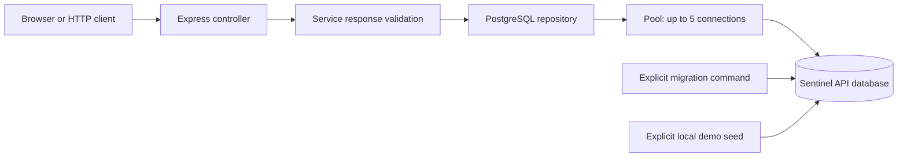
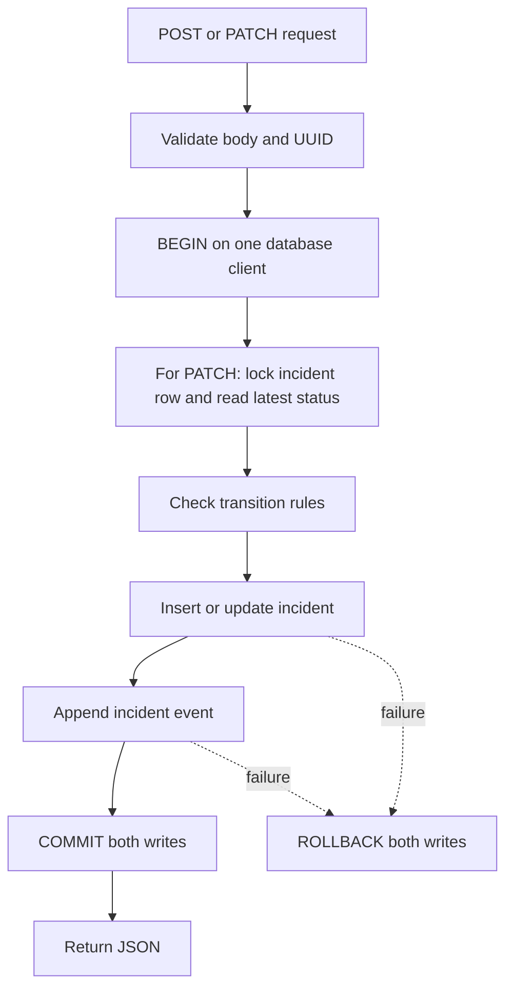
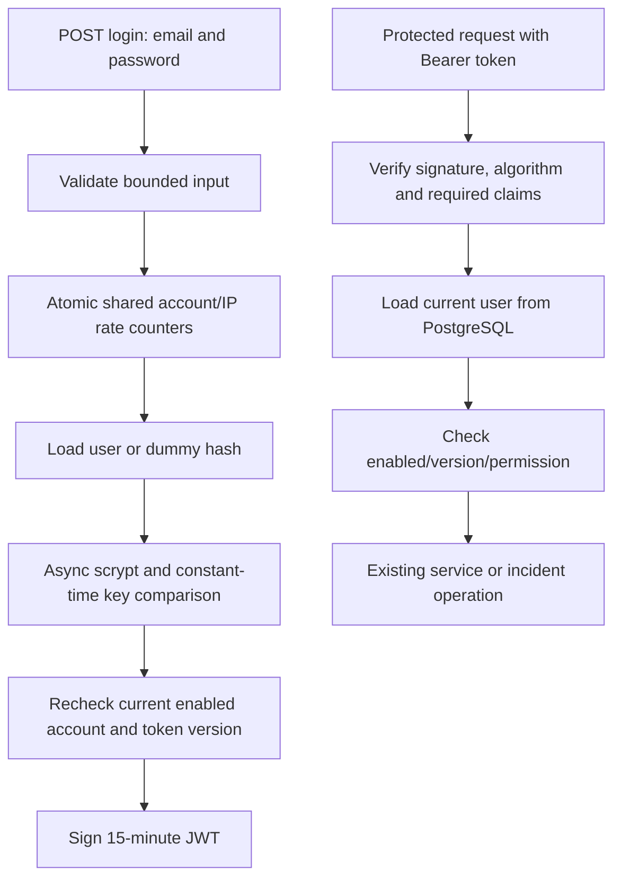

# P3 learning guide: Sentinel API and background jobs

## Scope and approval checkpoint

P3.1 was explained and approved by the user with "proceed" on 2026-10-16.
P3.2 was separately explained and approved with "proceed" on 2026-10-16.
P3.3 was separately explained and approved in the conversation. This guide documents
P3.1-P3.3; P3.4/P3.5 remain future tasks requiring approval. **Current behavior:**
protected API requests need a Bearer token. Earlier P3.1/P3.2 examples describe those
milestones before authentication; use the P3.3 section for current login/run commands
and add Authorization headers when reusing earlier API examples.
Commits identify the exact task, starting with
`feat(P3.1): bootstrap Sentinel API and service registry`.

## P3.1 Concept

The checkout/payment application generates the incidents Sentinel will eventually
investigate. The new Sentinel API is a different application: it stores which
services are monitored and will later own incidents, users and investigation
events. Registering a service does not start it, probe it or prove it is healthy.

A registry is a durable directory. Its two initial records describe the demo
checkout and payment services. These are explicitly seeded demonstration records,
not auto-discovered production services. PostgreSQL storage and HTTP responses are
real; no charge or AI investigation is performed in this task.

Express maps an HTTP method/path to an asynchronous handler. TypeScript catches
many mistakes before execution, but its types disappear at runtime. We therefore
also validate the values returned from the database before exposing them as JSON.

The node-postgres driver, `pg`, speaks PostgreSQL's protocol. A pool reuses database
connections, avoiding a new network/TLS handshake for each request. It is capped at
five connections per API process. Multiple future replicas would each have their
own pool, so hosting capacity must account for their combined connection count.

Direct SQL makes the query and transaction boundary visible to a beginner. An ORM
is an alternative that generates queries and types, but would add a second model
and migration abstraction at this stage. We retain one API migration owner.

## Architecture/data flow



The controller handles HTTP status and response shape. The service layer decides
what a valid result looks like. The repository runs SQL. They are small enough to
keep the service and repository in one file, `services.ts`, without creating an
empty abstraction for each layer. The `Registry` interface allows controlled fake
dependencies in unit tests; the running server uses PostgreSQL, without a memory
fallback.

For `GET /api/v1/services`, the handler awaits `listServices`. That function awaits
the repository's query. While waiting on database I/O, Node can process other
requests. The database still enforces its own constraints. Results are sorted by
name, allowlisted, validated and converted to UTC ISO timestamps before returning.
Thrown asynchronous route errors reach Express 5's error middleware.

### API contract

| Request                | Healthy response                                   | Failure response                                          |
| ---------------------- | -------------------------------------------------- | --------------------------------------------------------- |
| `GET /health`          | 200, `{"status":"ok","service":"sentinel-api"}`    | Does not query PostgreSQL                                 |
| `GET /ready`           | 200, `{"status":"ready","service":"sentinel-api"}` | 503 `NOT_READY` if database/schema unavailable            |
| `GET /api/v1/services` | 200, `{"services":[...]}`                          | 503 `DATABASE_UNAVAILABLE`; 500 for invalid stored output |
| Unknown route/method   | —                                                  | 404 `NOT_FOUND`                                           |

A service contains exactly `id`, `name`, `owner`, `environment`, `created_at`.
An empty registry returns `{"services":[]}`. The initial directory supports at most
100 returned entries; finding 101 fails explicitly instead of silently dropping
records. Pagination is a future extension. This endpoint accepts no filters.

Errors have `{error:{code,message},request_id}`. Each response carries a UUID
`x-request-id`. Valid incoming IDs are preserved; other values are replaced.
Responses disable caching and MIME sniffing. Logs contain only timestamp, service,
event, request ID, status, recognized route and duration. Query strings, arbitrary
paths, authorization headers and driver exception text are omitted.

### Schema and ownership

The local database is named `sentinel_api`, with tables inside the `sentinel_api`
schema. It is separate from P2's `sentinel` payment database and volume.

`services` has a UUID primary key, unique service name, owner, environment and
creation timestamp. Names use lowercase letters, digits and hyphens. Environment
is `development`, `staging` or `production`. Owner length is 1-100 characters.
PostgreSQL automatically indexes the primary key and unique name.

`sentinel_api.schema_migrations` records filenames, SHA256 checksums and application
times. The migration runner obtains a transaction advisory lock so two migration
commands cannot race. All pending migrations and their ledger records commit
together. Errors roll back the transaction. A changed or missing applied migration
is rejected: add a new migration rather than editing history. CRLF is normalized
to LF before hashing so Windows/Linux checkouts agree.

Migration files do not run during normal API startup. This keeps schema writes
explicit and allows a future deployment job to own migrations separately from
read/write runtime credentials.

## File plan and implementation walkthrough

All paths below are relative to the repository root `V:\sentinel\sentinel`.

| File                                            | Responsibility and important behavior                                                                                                                                                                                |
| ----------------------------------------------- | -------------------------------------------------------------------------------------------------------------------------------------------------------------------------------------------------------------------- |
| `apps/api/package.json`                         | Independent npm workspace; pinned Express 5.3.0, pg 8.23.1, TypeScript 5.9.3 and type declarations; build/test/start/migrate/seed commands                                                                           |
| `apps/api/tsconfig.json`                        | Strict compilation, Node ESM imports, generated output in ignored `dist/`                                                                                                                                            |
| `apps/api/src/config.ts`                        | `readConfig(env)` returns a typed configuration or throws a sanitized error; requires a PostgreSQL URL with credentials and database, validates port and TLS policy                                                  |
| `apps/api/src/db.ts`                            | `createPool(config)` returns a pg pool, bounds connection/query/lock times and handles idle connection errors without exposing secrets                                                                               |
| `apps/api/src/services.ts`                      | `postgresRegistry(pool)` returns real `ready`/`list` functions; `listServices(registry)` returns validated service records or throws; custom error classes distinguish an unavailable dependency from corrupt output |
| `apps/api/src/app.ts`                           | `createApp(registry, log)` returns Express without listening; injected dependency and log sink make HTTP behavior testable; controllers, correlation and sanitized error middleware                                  |
| `apps/api/src/server.ts`                        | Reads config, creates pool, listens on loopback, sets HTTP timeouts, handles occupied port and bounded shutdown on signals                                                                                           |
| `apps/api/database/migrations/001_services.sql` | Creates the constrained services table; no P2 migrations are changed                                                                                                                                                 |
| `apps/api/src/migrate.ts`                       | `migrate(pool, directory?)` returns applied filenames; acquires/releases a dedicated client and uses BEGIN/COMMIT/ROLLBACK; optional directory is for migration-negative tests                                       |
| `apps/api/src/seed.ts`                          | `seedDemoServices(pool)` inserts two stable UUID records in one transaction; name conflict preserves existing data; CLI restricts seeding to explicit loopback development configuration                             |
| `apps/api/test/api.test.ts`                     | Configuration, response validation, fake-dependency HTTP errors and safe logging tests                                                                                                                               |
| `apps/api/test/database.test.ts`                | Actual PostgreSQL migrations, seed, constraints, timeout and HTTP tests; runs only with an explicit dedicated verifier URL                                                                                           |
| `infrastructure/compose.api.yaml`               | Dedicated PostgreSQL 17.11 image pinned by digest, loopback port 55434, persistent volume, healthcheck; configurable ports/database for isolated verification                                                        |
| `scripts/api-local.py`                          | Creates ignored `.env.api` once, starts local database, builds, migrates, seeds and runs API; `--prepare-only` omits the long-running API process                                                                    |
| `scripts/verify-p3.py`                          | Starts uniquely named test database on an available port, runs all API tests, verifies process/database restarts and live outage, records result, removes owned test containers while preserving volume              |
| `package.json`, `package-lock.json`             | Adds API workspace, API commands and formatting coverage; root build/test cover both Node workspaces                                                                                                                 |
| `services/checkout-service/Dockerfile`          | Includes API manifest for workspace lock consistency while explicitly installing/building/pruning checkout dependencies; prevents the new workspace breaking P2's image                                              |
| `.env.example`                                  | Fake API examples and TLS setting names; contains no actual credentials                                                                                                                                              |
| `README.md`, `docs/PROGRESS.md`, this guide     | Operational entry point, measured evidence and learning reference                                                                                                                                                    |

The migration/seed functions use one checked-out client because a transaction must
stay on one connection. Ordinary registry reads use `pool.query`, which releases
its connection automatically. SQL values use `$1`, `$2`, etc. with separate argument
arrays instead of string interpolation. Fixed SQL identifiers are source-owned.
Connections are released in `finally` even when an operation throws.

Connection acquisition is limited to 3 seconds. PostgreSQL statements are limited
to 3 seconds, locks to 2 seconds, and the driver's query deadline is 4 seconds.
These limits bound individual operations; they do not constitute a global overload
budget. The API process has 10-second HTTP request and 5-second header timeouts.
Graceful shutdown stops accepting requests, closes the pool, and has a 6-second
forced-exit deadline. Windows verifier termination may be abrupt; persistence tests
intentionally confirm data survives that process restart too.

## Run/test

Use PowerShell from the actual nested repository:

```powershell
Set-Location V:\sentinel\sentinel
npm ci --no-audit --no-fund
.\.venv\Scripts\python.exe scripts/api-local.py
```

Prerequisites: Node 24/npm 11, the existing Python virtual environment, and running
Docker Desktop with Linux containers. Python dependencies were installed in P2.
If Docker is outside PATH, add the directory containing docker.exe to this terminal's
PATH so Docker plugins and credential helpers can also be found. The helper can
locate the standard per-user and per-machine executable paths.

Expected output includes `API migrations applied: 001_services.sql` on first run,
`Demo services seeded; existing names preserved` and a JSON `listening` event for
port 3000. Subsequent preparation reports migrations already current. Keep this
terminal open while testing. Ctrl+C stops the API; the database remains running.

Open `http://localhost:3000/api/v1/services`. The two records are JSON API output,
not the later React dashboard. This page does not yet push live changes; SSE is P3.5.

In a second terminal, positive tests:

```powershell
Invoke-RestMethod http://localhost:3000/health
Invoke-RestMethod http://localhost:3000/ready
(Invoke-RestMethod http://localhost:3000/api/v1/services).services | Format-Table
```

Expected: health `ok`, readiness `ready`, two service rows. Negative test:

```powershell
curl.exe -i http://localhost:3000/unknown
```

Expected: HTTP 404 with `NOT_FOUND` and matching request ID header/body. It must
not contain stack traces, passwords or connection strings.

Full isolated positive and negative verification:

```powershell
.\.venv\Scripts\python.exe scripts/verify-p3.py
```

At the original P3.1 milestone, 24 tests passed with zero skipped. The verifier is
now cumulative: its default task is P3.3, with 58 tests and authenticated restart checks.
Use `--task P3.1` for registry-only runtime checks (the cumulative database tests
still run). `npm run verify:p3.1` preserves that explicit selection.
It tests migration apply/replay, changed/missing history rejection, atomic rollback
of a failing migration, idempotent seed, unique/check constraints, actual SQL
statement cancellation, HTTP responses from real PostgreSQL, API/database restarts,
controlled outage and recovery. It does not stop the development database or use
the development API port. See `.artifacts/p3-1-verification.json` for measured result;
`RUNNING` or `FAILED` must never be interpreted as passed. Logs and retained test
volumes are local artifacts, not committed source.

Fast tests, build and formatting:

```powershell
npm test
npm run build
npm run format:check
.\.venv\Scripts\python.exe -m ruff check scripts/api-local.py scripts/verify-p3.py
.\.venv\Scripts\python.exe -m ruff format --check scripts/api-local.py scripts/verify-p3.py
```

Without `TEST_API_DATABASE_URL`, npm test explicitly skips the real database suite.
That is not a database pass. The full verifier sets a dedicated
`sentinel_api_verify` URL and executes those tests. Fake dependency tests simulate
failures; the integration verifier additionally stops a real test database.

To build/migrate/seed without leaving an API process running:

```powershell
.\.venv\Scripts\python.exe scripts/api-local.py --prepare-only
npm run start:api
```

To rerun migration explicitly after building (do not run a second API on port 3000):

```powershell
node --env-file=.env.api apps/api/dist/src/migrate.js
node --env-file=.env.api apps/api/dist/src/seed.js
```

To stop the development database without deleting its data:

```powershell
docker compose --env-file .env.api -f infrastructure/compose.api.yaml down
```

Do not add `-v`: that would delete the database volume. Only stop this database when
finished using the API. The P2 payment stack uses a different project and volume.

## Debug

- Cannot connect to localhost: check the API terminal's listening message and
  `SENTINEL_API_PORT` in the ignored local file. A browser tab alone does not start a server.
- Port in use: stop the process you own or choose another port in `.env.api`;
  do not terminate an unrelated process. The helper checks the API port first.
- `/health` succeeds but `/ready` returns 503: the process is alive but PostgreSQL
  or the schema is unavailable. Check Docker Desktop, database health, then the
  migration command. Readiness is deliberately stricter than process health.
- Empty services array: storage is reachable but not seeded. Use the explicit local
  seed command. The HTTP endpoint never invents default records.
- Migration checksum mismatch: restore the original applied file and add a new
  numbered migration. Do not edit the ledger or clear the volume to conceal the problem.
- Password mismatch after editing `.env.api`: PostgreSQL initializes a volume's
  password only once. Restore the matching local configuration; changing an env
  file does not rotate the existing database password. Do not delete the volume.
- `EACCES` during loopback tests in the restricted Codex shell: rerun using the
  host execution permission. The first restricted-shell HTTP attempt encountered
  this boundary; the host-run full verifier passed. It was not counted as success.
- TLS errors for a hosted database: check provider hostname and CA chain. Configure
  its CA certificate when necessary; never bypass certificate verification.

## Manual setup and hosted architecture

**No manual setup required for this local task** beyond existing prerequisites.
The local helper creates random credentials in ignored `.env.api`. Never paste
that file into chat or commit it. It owns local settings and must not be pointed
at a hosted database. It does not replace or print P2's `.env`.

The hosted system is not provisioned or publicly deployed. At the P3.1 milestone
the API was loopback-only and unauthenticated; P3.3 now adds authentication. A public host/bind configuration and
authentication must be addressed before exposure; P3.3 introduces identity/roles.
Public accessibility will not grant every user administrative permissions.

When provider selection is approved, manual/provider setup will include:

1. Provision a durable hosted PostgreSQL database and decide backup/restore policy.
2. Configure a migration identity with schema permissions and a separately scoped
   runtime identity. Store `SENTINEL_DATABASE_URL` in the backend host's secret store.
3. Use a PostgreSQL URL without query parameters and
   `SENTINEL_DATABASE_TLS=verify-full` (default). Set `SENTINEL_DATABASE_CA` to the
   provider's PEM CA certificate if the standard certificate trust store is insufficient.
4. Run reviewed API migrations as an explicit release step. The local demo seed
   CLI refuses remote hosts; production service registration needs its own approved flow.
5. Host the backend with HTTPS, suitable ingress and process lifecycle configuration.
   Redis and a separate worker are introduced in P3.4; durable event replay and SSE
   in P3.5 require hosting that supports long-lived streaming responses.

The TLS policy is verified in configuration tests; no live hosted TLS connection
or cloud provider has been tested. No paid resources, DNS records or public routes
were created. P2 demo tooling still intentionally restricts its own database hosts;
the new main API settings do not silently relax that separate guard.

## Understanding check

1. If `/health` returns 200 while `/ready` returns 503, which dependency would you
   inspect first, and why should the API avoid logging the raw database exception?
2. Trace `/api/v1/services` through controller, validation, repository and pool.
   Where does an unavailable database become HTTP 503? Where is `created_at` converted?
3. Why must migrations use one client and a transaction? What happens if the second
   statement fails, or two processes try to migrate simultaneously?

Independent modification (student exercise, not claimed completed): insert a third
development service using parameterized SQL or a reviewed local seed change. Choose
a new UUID and valid name, confirm it appears in sorted API output, restart the API
and confirm it remains. Then attempt the same name again and explain the unique
constraint result. Do not edit an already-applied migration to add seed data.

## Commit summary

`feat(P3.1): bootstrap Sentinel API and service registry` adds the separate API,
constrained schema, explicit migration/seed lifecycle, verified local workflow and
tests. Existing demo behavior is retained and checked by regression suites.
See PROGRESS.md for exact measured runs. Student mastery remains unconfirmed.
P3.2 and P3.3 are documented below. P3.4 requires the next approval checkpoint.

References: [pg pooling](https://node-postgres.com/features/pooling),
[pool options](https://node-postgres.com/apis/pool),
[TLS configuration](https://node-postgres.com/features/ssl).

## P3.2 Concept

An incident is a record describing a problem affecting a registered service. It
has a title, severity, status and timestamps. Creating one manually does not prove
that an outage exists: it records a report. Automatic detection and AI investigation
are later phases. The localhost example is explicitly labelled DEMO.

Severity describes impact (`LOW`, `MEDIUM`, `HIGH`, `CRITICAL`); status describes
progress. Changing one is not equivalent to changing the other. P3.2 allows status
updates only; title, service and severity are fixed after creation in this task.

A state machine is a set of allowed moves. Here it prevents jumping straight from
a newly opened incident to closed. An event is a durable record of creation or a
status change, providing ordered history that survives page/process restarts.
It is not yet a user-attributed audit trail; authentication arrives in P3.3.

### State rules

| Current status | Allowed different next statuses |
| -------------- | ------------------------------- |
| OPEN           | INVESTIGATING                   |
| INVESTIGATING  | MITIGATING, RESOLVED            |
| MITIGATING     | INVESTIGATING, RESOLVED         |
| RESOLVED       | INVESTIGATING, CLOSED           |
| CLOSED         | None                            |

Requesting the current status is a successful no-op: HTTP 200, no timestamp change
and no extra event. A forbidden move returns HTTP 409. Resolving sets `resolved_at`;
reopening clears it; closing preserves the latest resolution timestamp. An incident
can resolve directly from investigation when no mitigation step was needed.

## P3.2 Architecture/data flow



Creation inserts the incident and its `CREATED` event in one transaction. A status
change uses `SELECT ... FOR UPDATE` before applying rules. Another request targeting
the same row waits, then sees the latest committed status. Eight concurrent requests
for INVESTIGATING therefore produce one change event, followed by seven no-ops.
Requests for different incidents do not need to share that row lock.

The pool supplies a dedicated client for each transaction. Each `await` pauses that
operation until PostgreSQL responds without blocking Node's event loop. The client
is released in `finally`. If event insertion fails, `ROLLBACK` restores the incident
as well. No success response is sent before commit.

Reads use parameterized SQL and the existing bounded pool. SQL errors return a
sanitized storage-unavailable response; client mistakes and missing resources retain
their specific status codes. Runtime row readers allowlist fields and validate IDs,
status, severity, event payload and timestamps before returning them.

### Schema changes

`002_incidents.sql` adds two tables without changing `001_services.sql`:

- `incidents`: UUID primary key; service foreign key; title; severity/status;
  start, resolution and creation timestamps; internal bigint `list_position`.
- `incident_events`: UUID event identity; incident foreign key; bigint `sequence`;
  type; server-generated JSON payload; occurrence and storage timestamps.

Status/severity checks reject unknown values. Resolution constraints require a
timestamp exactly when status is RESOLVED/CLOSED and forbid resolution before start.
Foreign keys prevent orphan records. Indexes cover status/position, service/position
and incident/event sequence. No delete endpoint or cascading deletion was added.

The API repository enforces transitions and paired incident/event writes. Database
owner credentials can bypass those application rules with direct SQL; enum/check
constraints alone do not implement a state machine. Hosted runtime credentials and
authorized API access must be scoped before public deployment.

### Pagination and ordering

The incident list uses descending `list_position`; event history uses ascending
`sequence`. PostgreSQL allocates these integers, avoiding timestamp ties and loss
of microsecond precision when timestamps become JavaScript Dates. Bigints remain
strings in JSON rather than risking JavaScript number rounding. Rollbacks can leave
sequence gaps; a gap is not proof of a missing event.

Each page returns `next_cursor` or null. The opaque base64url cursor contains a
version, position and query scope. Changing incident filters or using another
incident's event cursor is rejected. Cursors are validated navigation state, not
encrypted data, authentication tokens or access grants.

Pages default to 20 records, with limits 1-100. The repository fetches one extra
row to decide whether another page exists. Incident pages use positions below the
last returned one; event pages use sequences above it. Event history is ordered per
incident, not by a guarantee about global commit order across different incidents.
Pagination is not a frozen database snapshot: concurrent creations or status-filter
membership changes may require refreshing the list. SSE/live refresh arrives in P3.5.

## P3.2 File plan and approval checkpoint

The user approved the described routes, schema, state rules, tests and localhost
preview. No new npm or Python dependencies were needed. Changes are limited to:

| File                                             | Implementation and walkthrough                                                                                                                                                              |
| ------------------------------------------------ | ------------------------------------------------------------------------------------------------------------------------------------------------------------------------------------------- |
| `apps/api/database/migrations/002_incidents.sql` | Tables, foreign keys, checks and indexes; executed by the existing migration owner                                                                                                          |
| `apps/api/src/incidents.ts`                      | Types and `IncidentStore` contract; `parseCreate`, `parseTransition`, `parseId`, `parseList`; transition table; cursor encoding/validation; `readIncident` and `readEvent` response readers |
| `apps/api/src/incident-repository.ts`            | `postgresIncidents(pool)` returns create/list/get/transition/events/ready functions; private database wrapper sanitizes failures, transaction helper owns commit/rollback/release           |
| `apps/api/src/incident-routes.ts`                | Express router translates validated HTTP requests to store calls; creation returns 201 and Location header                                                                                  |
| `apps/api/src/app.ts`                            | Optional injected incident store keeps existing registry tests independent; mounts router with 8 KiB JSON limit, extends readiness and safe error/log handling                              |
| `apps/api/src/server.ts`                         | Supplies the real PostgreSQL incident store to the running application                                                                                                                      |
| `apps/api/test/incidents.test.ts`                | Boundary validation, all 25 status pairs, cursor rules and HTTP contracts with a fake dependency                                                                                            |
| `apps/api/test/incident-database-checks.ts`      | Real incident transactions, forced event-write failure, eight-way concurrency, observed lock wait, pagination, constraints and HTTP checks                                                  |
| `apps/api/test/database.test.ts`                 | Migrates an actual P3.1 schema with existing services to P3.2, preserves checksum/replay checks and invokes incident integration tests sequentially on its isolated database                |
| `scripts/verify-p3.py`                           | Task selector and separate reports; P3.2 creates an incident/event pair and confirms it survives API/database restarts and real database outage                                             |
| `package.json`                                   | Adds `verify:p3.2`; existing `verify:p3.1` selects its task explicitly                                                                                                                      |
| README, learning guide, progress log             | Commands, explanation, measured results, hosting/manual setup and pending learner work                                                                                                      |

`parseCreate` accepts exactly service_id/title/severity, trims title, rejects empty
or over-200-character titles and control characters, and requires a UUID service ID.
`parseTransition` accepts only `{status}`. IDs are normalized to lowercase.
`parseList` rejects extra/repeated query fields, invalid filters and unbounded limits.

`create` returns an incident after both writes commit; a missing service returns 404.
`transition(id, status)` locks, reads, validates, changes resolution time if needed,
appends a status event and returns the committed incident. A repeated status returns
the existing row. `list(options)` returns `{incidents,next_cursor}`; `events(id,options)`
returns `{events,next_cursor}` and rejects a missing incident. SQL parameter arrays
hold request values; only source-owned SQL column names/operators are interpolated.

## P3.2 Run/test

API contracts:

| Request                          | Success                       | Main negative cases                                 |
| -------------------------------- | ----------------------------- | --------------------------------------------------- |
| POST /api/v1/incidents           | 201 incident, Location header | 422 invalid fields; 404 SERVICE_NOT_FOUND           |
| GET /api/v1/incidents            | 200 incidents + next_cursor   | 422 invalid filter/limit; 400 INVALID_CURSOR        |
| GET /api/v1/incidents/:id        | 200 incident                  | 422 invalid UUID; 404 INCIDENT_NOT_FOUND            |
| PATCH /api/v1/incidents/:id      | 200 incident                  | 409 INVALID_STATUS_TRANSITION; 404 missing incident |
| GET /api/v1/incidents/:id/events | 200 events + next_cursor      | 400 wrong cursor; 404 missing incident              |

Write endpoints require application/json (415 otherwise). Malformed JSON returns
400; JSON bodies over 8 KiB return 413. Database failures return 503 without SQL,
connection strings, passwords or request body contents. Existing health/services
contracts are preserved; readiness now also requires the incident tables.

After stopping your existing API process, run from `V:\sentinel\sentinel`:

```powershell
.\.venv\Scripts\python.exe scripts/api-local.py
```

Expected first upgrade: `API migrations applied: 002_incidents.sql`, then listening
on port 3000. Existing services and volume remain intact. Subsequent runs report
migrations already current. Open http://localhost:3000/api/v1/incidents.

Positive manual example in a second PowerShell terminal:

```powershell
$body = @{service_id='11111111-1111-4111-8111-111111111111'; title='DEMO: my learning incident'; severity='HIGH'} | ConvertTo-Json
$incident = Invoke-RestMethod http://localhost:3000/api/v1/incidents -Method Post -ContentType application/json -Body $body
$incident.status
# Expected OPEN; HTTP creation status is 201.

$incident = Invoke-RestMethod "http://localhost:3000/api/v1/incidents/$($incident.id)" -Method Patch -ContentType application/json -Body '{"status":"INVESTIGATING"}'
$incident.status
# Expected INVESTIGATING.

(Invoke-RestMethod "http://localhost:3000/api/v1/incidents/$($incident.id)/events").events | Format-Table
# Expected CREATED and STATUS_CHANGED, in sequence order.
```

Negative test: INVESTIGATING cannot jump straight to CLOSED:

```powershell
try {
    Invoke-RestMethod "http://localhost:3000/api/v1/incidents/$($incident.id)" -Method Patch -ContentType application/json -Body '{"status":"CLOSED"}'
} catch {
    $_.Exception.Response.StatusCode.value__
}
# Expected 409. Status stays INVESTIGATING and no event is added.
```

Listing/filtering/pagination:

```powershell
Invoke-RestMethod 'http://localhost:3000/api/v1/incidents?status=INVESTIGATING&limit=1'
$page = Invoke-RestMethod 'http://localhost:3000/api/v1/incidents?limit=1'
if ($page.next_cursor) {
    $cursor = [uri]::EscapeDataString($page.next_cursor)
    Invoke-RestMethod "http://localhost:3000/api/v1/incidents?limit=1&cursor=$cursor"
}
```

The creation endpoint does not deduplicate POST retries in this task. Each successful
POST creates a new UUID incident. After a lost response, inspect the list before
manually repeating creation. Same-status PATCH is a no-op, but it is not an optimistic
version check against an earlier client snapshot; rules apply to current database status.

Full cumulative verification with real PostgreSQL:

```powershell
.\.venv\Scripts\python.exe scripts/verify-p3.py --task P3.2
# Or: npm run verify:p3.2
```

Expected at this milestone: 41 tests pass, zero failed/skipped, then PASS: P3.2.
Report: `.artifacts/p3-2-verification.json`. Each run has a new isolated project,
dedicated database and available ports. Test containers/network are removed without
deleting their data volume. The development localhost database is not stopped.

Tests include upgrade/replay/checksum protection, missing references, forced failure
of the second transaction write, eight concurrent repeated transitions, an observed
row-lock wait followed by validation against the changed status, resolution/reopen
rules, terminal CLOSED, filters, complete incident/event pagination, database checks,
JSON limits and redaction. The verifier additionally kills/restarts its own API and
stops/restarts its own database, comparing incident/event records after recovery.

`npm test` runs fast HTTP/config/state-machine tests and skips the dedicated DB suite
unless TEST_API_DATABASE_URL is supplied. The 41-test result comes from the full
verifier, not that skipped invocation. No live hosted database was tested.

## P3.2 Debug

- 404 on every incident endpoint while services works: stop the old P3.1 process,
  build and start the updated API. Refreshing a tab does not reload Node code.
- Readiness 503 after upgrade: check the database and apply migrations; having only
  the services table is no longer enough. Do not alter applied migration 001.
- 422: confirm the exact field names, uppercase enum values, UUID and title length.
  Do not send client-generated status/id/timestamps during creation.
- 409: read current incident status and the transition table. A concurrent request
  may have changed status while yours waited. The rejected request adds no event.
- 400 INVALID_CURSOR: reuse the same filters and incident ID that produced the
  cursor. Restart at the first page after changing filters.
- 503 during a write: the response intentionally omits driver details. Check local
  database health and migration history. An uncertain network/commit outcome must
  be reconciled by reading records; do not assume every failed response means rollback.
- Sequence gaps: expected after rolled-back transactions and across different
  incidents. Follow next_cursor instead of incrementing sequence numbers yourself.

## P3.2 Manual setup and hosting

**No manual setup required for this local upgrade.** The existing helper explicitly
runs migration 002 before starting Node, using the existing ignored credentials and
volume. There are no new accounts, environment variables, database services or fees.

For a future hosted release, run reviewed migration 002 through the approved
migration job before rolling out the new API. Keep the database durable, preserve
backups, and verify readiness after rollout. Existing verified-TLS database settings
remain applicable. Hosted provisioning/deployment has not occurred.

At the P3.2 milestone the API was loopback-only and unauthenticated. P3.3 below adds
login/roles; the listener still remains loopback-only. P3.5 adds real-time progress streaming backed by persisted events; the
current browser displays JSON snapshots and requires refresh to fetch changes.

## P3.2 Understanding check

1. Why must changing status and appending the event use one client and transaction?
   What should you see after the test deliberately rejects the event insert?
2. Why does the transition check happen after SELECT FOR UPDATE? Explain what the
   waiting request sees when another transaction resolves the incident first.
3. Why use a bigint position for pagination instead of a JavaScript timestamp?
   Why can valid event sequences contain gaps?

Independent exercise (not completed by Codex on the student's behalf): create your
own labelled learning incident, progress it through investigation and resolution,
reopen it, and inspect resolved_at and event history after each step. Attempt one
forbidden transition and explain why it left history unchanged.

## P3.2 Commit summary

`feat(P3.2): add incidents and transactional event history` implements the approved
REST contracts, state machine, durable history and pagination with positive/negative
tests. The localhost demo is separate from isolated test data. See PROGRESS.md for
measured evidence. Student comprehension/exercise remains pending. P3.3 is below;
P3.4 requires a separate explanation and approval before implementation.

Reference: [PostgreSQL row locking](https://www.postgresql.org/docs/17/explicit-locking.html).

## P3.3 Concept

Authentication identifies the caller; authorization checks what that caller may do.
The backend enforces both. Hiding a button is not authorization: a caller can send
HTTP directly without using the page. A viewer must receive 403 for incident writes
even when manually constructing the request.

A password hash is a one-way derivation, not reversible encryption. Each account
gets a random salt so equal passwords produce different stored values. Scrypt adds
deliberate CPU and memory cost, making guessing against stolen hashes more expensive.
We use Node's asynchronous built-in implementation: N=131072, r=8, p=1, 16-byte salt,
32-byte derived key. The version/parameters, salt and derived key are stored together.
Only those fixed parameters are accepted during verification; stored text cannot
request an arbitrary amount of computation.

Scrypt is a dependency-free option in our Node runtime; Argon2id is a common
alternative. The selected scrypt parameters follow OWASP guidance. Each derivation
needs roughly 128 MiB; the API allows at most two at once (roughly 256 MiB plus runtime
overhead), with no unbounded waiting queue. Extra work gets controlled 503 AUTH_BUSY.
The callback form lets the event loop serve other requests while hashing runs.

A JWT is a signed, readable set of claims. The server signs it with an environment
secret; the browser must never receive that signing secret. Our HS256 tokens identify
a user UUID and token version, with issuer, audience, issued/expiry times and a unique
token ID. They expire after 15 minutes, with up to five seconds of clock tolerance.
They contain neither passwords nor password hashes; roles are read fresh from the DB.

JWTs avoid per-token session records but complicate revocation. Here every protected
request reloads the account and compares token_version. Disabling/enabling or resetting
a password increments that version, invalidating older tokens. Role changes are seen
on the next authentication check. Already-authorized in-flight requests may finish;
future privileged action execution must recheck authorization when it executes.

## P3.3 Architecture/data flow



Unknown valid email, wrong password and disabled account return the same generic 401. Unknown accounts still perform a normal-cost dummy verification to reduce
obvious timing differences. This is not a claim of identical end-to-end timing.
Before issuing a token, login reloads the account after hashing to reject a password
reset that happened while hashing was in progress.

The JWT verifier accepts only HS256, JWT type, our issuer/audience, required claims
and a bounded lifetime. It rejects malformed/oversized Authorization headers,
incorrect signatures, expired tokens and token-version mismatches. Tokens in URL
queries or cookies are not accepted. Database unavailability returns 503 instead of
letting callers bypass identity checks.

### Roles and API changes

| Role     | Read services/incidents/events | Create/change incidents | Reserved action approval permission |
| -------- | ------------------------------ | ----------------------- | ----------------------------------- |
| VIEWER   | Yes                            | No                      | No                                  |
| OPERATOR | Yes                            | Yes                     | No                                  |
| ADMIN    | Yes                            | Yes                     | Yes                                 |

Approval/remediation endpoints are not implemented. The reserved approval guard is
tested on the backend; it is not an executable action route.

| Endpoint                           | Behavior                                                                                                                                        |
| ---------------------------------- | ----------------------------------------------------------------------------------------------------------------------------------------------- |
| POST /api/v1/auth/login            | application/json with exactly email/password; 200 token/profile, generic 401 credentials error, 422 fields, 429 throttled, 503 unavailable/busy |
| GET /api/v1/auth/me                | Requires Bearer token; returns id/email/current role only                                                                                       |
| Existing services/incidents/events | Authentication required; incident POST/PATCH additionally require write permission                                                              |
| GET /health, /ready                | Remain public with no account or database details                                                                                               |
| GET /auth-test and its two assets  | Public local testing surface; protected fetches still require login                                                                             |

`401` means valid authentication was not provided. `403` means an authenticated
caller lacks permission. Error bodies preserve the existing request-ID contract.
Unknown paths under the protected API prefix may return 401 before route lookup;
an unknown public path still returns 404.

### Shared login throttling

PostgreSQL stores fixed-window counters: at most 10 attempts per normalized email
and 30 per direct peer IP over 15 minutes, counting successful and failed logins.
Account/IP keys are HMAC-SHA256 values, not plaintext emails/IPs. Counter increments
are atomic and rows are acquired in consistent order. Different API instances using
the same DB and signing secret share these limits; restarting Node does not clear them.

Expired rows older than one day are removed in batches of at most 100 on subsequent
logins. There is no scheduled deletion deadline while the application is idle.
The limiter fails closed when its database is unavailable. It intentionally ignores
X-Forwarded-For: untrusted callers must not choose their own IP bucket.

These are initial controls, not complete internet abuse protection. An attacker can
temporarily consume an email's allowance; users behind the same proxy share an IP
allowance. Public deployment needs provider-specific trusted-proxy/edge rate-limit
configuration, HTTPS and capacity decisions before exposure.

## P3.3 File plan and approval checkpoint

The concept, role policy, hashing/token choices, tests, localhost testing page and
manual hidden-password setup were explained and approved before coding.

| File                                                      | Implementation/walkthrough                                                                                                                                                                  |
| --------------------------------------------------------- | ------------------------------------------------------------------------------------------------------------------------------------------------------------------------------------------- |
| `apps/api/database/migrations/003_users.sql`              | Users with normalized unique email, password hash, role, enabled flag, token version/timestamps; shared login-limit table and cleanup index                                                 |
| `apps/api/src/passwords.ts`                               | `hashPassword(password)` returns salted encoded hash; `verifyPassword(password,encoded)` derives and compares 32-byte keys using timingSafeEqual; fixed work parameters and two-job ceiling |
| `apps/api/src/auth.ts`                                    | Types, bounded login parsing, secret validation, safe profiles, `createAuth(store,secret)` login/token verification, permission matrix and Express authentication/authorization middleware  |
| `apps/api/src/auth-store.ts`                              | Parameterized user lookup and atomic rate counters; explicit `createUser` and `manageUser` for create/password/role/enable/disable operations                                               |
| `apps/api/src/user-cli.ts`                                | Bounded JSON on stdin, loopback development DB guard, no password command argument or output; calls account-management functions                                                            |
| `apps/api/src/app.ts`                                     | Login before protected prefix, public test page/assets, authenticated profile and route guards; safe auth errors and readiness including auth tables                                        |
| `apps/api/src/server.ts`                                  | Requires valid signing secret before listening and always supplies real PostgreSQL auth; no runtime auth-disable switch                                                                     |
| `apps/api/public/auth-test.html`, `.js`, `.css`           | Minimal login/profile/read/write testing page, safe textContent output, memory-only token and external scripts/styles under restrictive CSP                                                 |
| `scripts/api-user.py`                                     | Hidden password/confirmation through getpass in an interactive terminal, then JSON over child stdin; refuses noninteractive password entry rather than echoing it                           |
| `scripts/api-local.py`                                    | Adds a missing random signing secret to ignored .env.api while preserving existing settings, then migrates before startup; does not create accounts                                         |
| `apps/api/test/auth.test.ts`, `auth-database-checks.ts`   | Password/JWT/role/HTTP unit cases and real users, counters, permissions, resets and disable/enable integration checks                                                                       |
| `apps/api/test/auth-fixture.ts` and existing domain tests | Explicit fake ADMIN identity isolates old registry/incident rule tests; real auth tests remain separate                                                                                     |
| `scripts/verify-p3.py`                                    | Cumulative suite, temporary explicit CLI-created test operator, authenticated runtime/restarts/outage checks and P3.3 report                                                                |
| manifests/lockfile, .env.example, README/progress/guide   | Pinned jose 6.2.12, scripts/asset formatting, fake secret placeholder and full operational/learning reference                                                                               |

`createAuth.login(email,password,ip)` checks shared limits, obtains a stored/dummy
hash, awaits derivation, checks enabled/version, and returns token_type/expires_in/
access_token/user. The raw token is returned only to the login client.
`authenticate(header)` verifies claims before any user lookup, then returns a safe
profile. `authenticated` places that profile in response.locals; `requirePermission`
checks it before calling existing handlers. Missing auth dependencies deny protected
requests; the normal server has no environment bypass.

Account operations are explicit administrative CLI actions, not public registration.
Create has no default role or password. Role change keeps token_version unchanged
because the next request reads the role; password reset/disable/enable increment it.
Email normalization trims and lowercases. Passwords are never trimmed or normalized:
their exact characters matter. New passwords must be 12-128 characters, at most
512 UTF-8 bytes; there are no forced symbol/capital rules or silent truncation.

The testing page holds the token only in its JS variable, clears the password field
after login attempts, and does not display/store tokens in the response panel,
localStorage, sessionStorage, cookies or URLs. Reload requires login again. Forget
token clears only that page's copy; it is not server-side revocation of stolen copies.
Both passwords and tokens must be protected by HTTPS in a hosted deployment.

## P3.3 Run/test and manual account setup

From `V:\sentinel\sentinel`, install locked dependencies if needed and start:

```powershell
npm ci --no-audit --no-fund
.\.venv\Scripts\python.exe scripts/api-local.py
```

Expected first upgrade: a missing JWT secret is generated in ignored .env.api;
migration 003 applies; existing services/incidents remain; API listens on port 3000.
The helper creates **no default user**. Stop an existing owned API before restarting;
the helper refuses an occupied API port rather than terminating another process.

**Manual step required:** in your own second interactive PowerShell terminal, choose
an email and password. Replace the example email; no email is sent by this local tool.

```powershell
Set-Location V:\sentinel\sentinel
.\.venv\Scripts\python.exe scripts/api-user.py create --email you@example.com --role ADMIN
```

Enter a unique 12-128-character password twice at hidden prompts. Do not put it in
arguments, chat, screenshots or a committed file. Expected output:
`Local account operation completed; credentials omitted`. Repeating create for the
same normalized email fails safely; it does not reset that account.

Open http://localhost:3000/auth-test, enter your account, and log in. Use My profile,
Services and Incidents. Expected: login HTTP 200, a safe profile, then real database
responses. The page is a testing aid, not the P9 dashboard. Direct navigation to
/api/v1/incidents cannot attach the page's memory token, so it still returns 401;
use the page's button or an authenticated HTTP client.

Positive/negative role exercise commands (password entry remains hidden):

```powershell
.\.venv\Scripts\python.exe scripts/api-user.py create --email viewer@example.com --role VIEWER
.\.venv\Scripts\python.exe scripts/api-user.py create --email operator@example.com --role OPERATOR
```

Log in as viewer, read Incidents (200), then submit the page's incident form (403).
Log in as operator and submit a labelled demo incident for an existing service UUID
(201). This creates actual local demo data. A valid role never bypasses P3.2's
transition/validation rules.

Account maintenance commands, run only intentionally for your chosen local account:

```powershell
.\.venv\Scripts\python.exe scripts/api-user.py password --email you@example.com
.\.venv\Scripts\python.exe scripts/api-user.py role --email viewer@example.com --role OPERATOR
.\.venv\Scripts\python.exe scripts/api-user.py disable --email viewer@example.com
.\.venv\Scripts\python.exe scripts/api-user.py enable --email viewer@example.com
```

Password action prompts twice, changes the hash and revokes older tokens. Disable
blocks login/current tokens; enable does not resurrect old tokens. User-management
CLI is limited to explicit loopback development databases. Hosted account bootstrap
must be a separately approved administrative procedure; this script will not target
a remote URL silently.

Full independent verification (does not require or use your personal account):

```powershell
.\.venv\Scripts\python.exe scripts/verify-p3.py --task P3.3
# Or npm run verify:p3.3
```

Expected: 58 tests pass, none failed/skipped, then PASS: P3.3. Temporary random
passwords, signing key and users belong only to a uniquely named verification DB;
they are not default development credentials. The verifier also exercises the
account CLI through stdin, signs in, checks protected HTTP, restarts its own API/DB,
and confirms the original token and incident/history still work afterward.
During DB outage protected reads/writes fail with AUTH_UNAVAILABLE 503; health stays
200 and readiness 503. It removes owned test containers/network and retains the volume.

`npm test` includes fast auth tests but skips the dedicated DB suite without the
verifier's explicit TEST_API_DATABASE_URL. Fake-auth domain tests do not establish
authentication correctness; that comes from JWT-specific and real-user integration
tests. Actual tests include salted hashing, two-job ceiling, tampering, expiry,
wrong issuer/audience/algorithm/type, missing claims, password reset race, invalidated
versions, safe profiles, role guards, shared atomic counters and expiry.

Browser inspection confirmed the form and a real unauthenticated Services fetch
returning 401. Your personal account and successful browser login are pending manual
setup; automated real login/role checks passed on the isolated backend. The hidden
interactive prompt itself was not populated by Codex.

## P3.3 Debug

- API will not start: check valid database/TLS settings and a 64-hex-character
  SENTINEL_JWT_SECRET. api-local.py creates a missing local secret; it does not
  silently replace an invalid existing one. Never print the file to debug it.
- Login 401: check normalized email, exact password, enabled state and that the
  account was created in this local database. The generic message intentionally
  does not distinguish an unknown email from a wrong password.
- Protected 401 after reload: the token was memory-only. Log in again. For API
  tools, send Authorization: Bearer token; never put it in the URL.
- 403: authentication succeeded, but the database role lacks the required permission.
  Inspect My profile instead of changing UI code or trusting a claimed JWT role.
- 429: wait for the 15-minute counter window; restarting Node does not reset it.
  Account/IP limits include successful attempts. Do not delete counters to claim a
  production control works; tests expire only isolated test records intentionally.
- AUTH_BUSY 503: two memory-intensive derivations are already active; retry shortly.
  AUTH_UNAVAILABLE 503: check DB/schema health. Neither case authorizes a fallback.
- Password prompt refuses automation: run api-user.py in your own interactive
  terminal. It refuses to fall back to visible password input.
- Existing token stops working after password reset/disable/key rotation: expected.
  Sign in again after the account is enabled and valid credentials are available.

## P3.3 Hosted integration and remaining manual work

Local manual account creation is still required; there is no default account or
public signup. The existing helper handles local secret generation and schema
upgrade. No hosted resource was provisioned or externally deployed.

Before public hosting, the user/provider setup must include:

1. Run migration 003 using the approved migration identity, preserving prior data.
2. Generate one cryptographically random 32-byte secret encoded as 64 hex characters;
   configure SENTINEL_JWT_SECRET in the provider's secret manager for every API
   instance. Do not expose it to the browser/AI engine or commit it. Planned rotation
   changes the secret on all instances and invalidates older tokens.
3. Use the existing verified-TLS PostgreSQL configuration. Runtime identity needs
   scoped user reads and rate-counter access in addition to application tables;
   user creation/reset should remain administrative, not publicly exposed.
4. Bootstrap the initial administrator through an explicitly approved hosted admin
   procedure. The provided local CLI deliberately refuses remote databases.
5. Configure HTTPS, a deliberate public bind/ingress, trusted proxy handling and
   edge abuse controls. The current API still binds only to loopback.
6. Choose host memory/connection capacity for up to two roughly 128 MiB scrypt jobs
   per API process plus runtime overhead. Cost/provider choice remains unselected.

There is no MFA, email verification, self-service password recovery, refresh-token
flow or per-token logout revocation in P3.3. API access checks do not make this a
finished public deployment. P3.4 introduces the queue/worker; P3.5 must account for
authentication and expiry on long-lived event streams.

## P3.3 Understanding check

1. What is stored with a password hash, and why do equal passwords have different
   stored hashes? Why does the API limit simultaneous derivations?
2. Why does verifying a signed JWT still require a database lookup and permission
   check? Explain password reset versus a role change for an existing token.
3. Explain 401, 403, 429 and 503 using the login/testing page. Why does forgetting
   the token in one tab not revoke a copy held elsewhere?

Independent exercise: create a VIEWER, confirm read success and write refusal, then
change its role intentionally and inspect how its existing token behaves. Record
the results without saving passwords/tokens in your learning notes. Student
completion has not been claimed.

## P3.3 Commit summary

`feat(P3.3): add login and role-based API authorization` adds the approved auth layer,
local account lifecycle, shared login limits, safe localhost testing page and tests.
Measured evidence is in PROGRESS.md. Local personal account setup remains pending.
P3.4 needs a new concept/design explanation and approval.

References: [OWASP password storage](https://cheatsheetseries.owasp.org/cheatsheets/Password_Storage_Cheat_Sheet.html),
[Node crypto](https://nodejs.org/docs/latest-v24.x/api/crypto.html),
[jose documentation](https://github.com/panva/jose).
