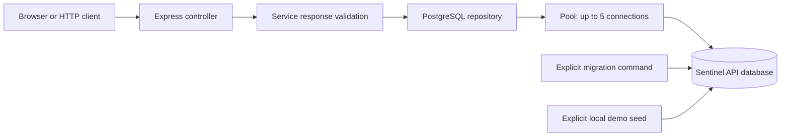

# P3 learning guide: Sentinel API and background jobs

## Scope and approval checkpoint

P3.1 was explained and approved by the user with "proceed" on 2026-10-16.
This guide documents P3.1 only. P3.2-P3.5 remain future tasks requiring approval.
Commits identify the exact task, starting with
`feat(P3.1): bootstrap Sentinel API and service registry`.

## P3.1 Concept

The checkout/payment application generates the incidents Sentinel will eventually
investigate. The new Sentinel API is a different application: it stores which
services are monitored and will later own incidents, users and investigation
events. Registering a service does not start it, probe it or prove it is healthy.

A registry is a durable directory. Its two initial records describe the demo
checkout and payment services. These are explicitly seeded demonstration records,
not auto-discovered production services. PostgreSQL storage and HTTP responses are
real; no charge or AI investigation is performed in this task.

Express maps an HTTP method/path to an asynchronous handler. TypeScript catches
many mistakes before execution, but its types disappear at runtime. We therefore
also validate the values returned from the database before exposing them as JSON.

The node-postgres driver, `pg`, speaks PostgreSQL's protocol. A pool reuses database
connections, avoiding a new network/TLS handshake for each request. It is capped at
five connections per API process. Multiple future replicas would each have their
own pool, so hosting capacity must account for their combined connection count.

Direct SQL makes the query and transaction boundary visible to a beginner. An ORM
is an alternative that generates queries and types, but would add a second model
and migration abstraction at this stage. We retain one API migration owner.

## Architecture/data flow



The controller handles HTTP status and response shape. The service layer decides
what a valid result looks like. The repository runs SQL. They are small enough to
keep the service and repository in one file, `services.ts`, without creating an
empty abstraction for each layer. The `Registry` interface allows controlled fake
dependencies in unit tests; the running server uses PostgreSQL, without a memory
fallback.

For `GET /api/v1/services`, the handler awaits `listServices`. That function awaits
the repository's query. While waiting on database I/O, Node can process other
requests. The database still enforces its own constraints. Results are sorted by
name, allowlisted, validated and converted to UTC ISO timestamps before returning.
Thrown asynchronous route errors reach Express 5's error middleware.

### API contract

| Request                | Healthy response                                   | Failure response                                          |
| ---------------------- | -------------------------------------------------- | --------------------------------------------------------- |
| `GET /health`          | 200, `{"status":"ok","service":"sentinel-api"}`    | Does not query PostgreSQL                                 |
| `GET /ready`           | 200, `{"status":"ready","service":"sentinel-api"}` | 503 `NOT_READY` if database/schema unavailable            |
| `GET /api/v1/services` | 200, `{"services":[...]}`                          | 503 `DATABASE_UNAVAILABLE`; 500 for invalid stored output |
| Unknown route/method   | —                                                  | 404 `NOT_FOUND`                                           |

A service contains exactly `id`, `name`, `owner`, `environment`, `created_at`.
An empty registry returns `{"services":[]}`. The initial directory supports at most
100 returned entries; finding 101 fails explicitly instead of silently dropping
records. Pagination is a future extension. This endpoint accepts no filters.

Errors have `{error:{code,message},request_id}`. Each response carries a UUID
`x-request-id`. Valid incoming IDs are preserved; other values are replaced.
Responses disable caching and MIME sniffing. Logs contain only timestamp, service,
event, request ID, status, recognized route and duration. Query strings, arbitrary
paths, authorization headers and driver exception text are omitted.

### Schema and ownership

The local database is named `sentinel_api`, with tables inside the `sentinel_api`
schema. It is separate from P2's `sentinel` payment database and volume.

`services` has a UUID primary key, unique service name, owner, environment and
creation timestamp. Names use lowercase letters, digits and hyphens. Environment
is `development`, `staging` or `production`. Owner length is 1-100 characters.
PostgreSQL automatically indexes the primary key and unique name.

`sentinel_api.schema_migrations` records filenames, SHA256 checksums and application
times. The migration runner obtains a transaction advisory lock so two migration
commands cannot race. All pending migrations and their ledger records commit
together. Errors roll back the transaction. A changed or missing applied migration
is rejected: add a new migration rather than editing history. CRLF is normalized
to LF before hashing so Windows/Linux checkouts agree.

Migration files do not run during normal API startup. This keeps schema writes
explicit and allows a future deployment job to own migrations separately from
read/write runtime credentials.

## File plan and implementation walkthrough

All paths below are relative to the repository root `V:\sentinel\sentinel`.

| File                                            | Responsibility and important behavior                                                                                                                                                                                |
| ----------------------------------------------- | -------------------------------------------------------------------------------------------------------------------------------------------------------------------------------------------------------------------- |
| `apps/api/package.json`                         | Independent npm workspace; pinned Express 5.3.0, pg 8.23.1, TypeScript 5.9.3 and type declarations; build/test/start/migrate/seed commands                                                                           |
| `apps/api/tsconfig.json`                        | Strict compilation, Node ESM imports, generated output in ignored `dist/`                                                                                                                                            |
| `apps/api/src/config.ts`                        | `readConfig(env)` returns a typed configuration or throws a sanitized error; requires a PostgreSQL URL with credentials and database, validates port and TLS policy                                                  |
| `apps/api/src/db.ts`                            | `createPool(config)` returns a pg pool, bounds connection/query/lock times and handles idle connection errors without exposing secrets                                                                               |
| `apps/api/src/services.ts`                      | `postgresRegistry(pool)` returns real `ready`/`list` functions; `listServices(registry)` returns validated service records or throws; custom error classes distinguish an unavailable dependency from corrupt output |
| `apps/api/src/app.ts`                           | `createApp(registry, log)` returns Express without listening; injected dependency and log sink make HTTP behavior testable; controllers, correlation and sanitized error middleware                                  |
| `apps/api/src/server.ts`                        | Reads config, creates pool, listens on loopback, sets HTTP timeouts, handles occupied port and bounded shutdown on signals                                                                                           |
| `apps/api/database/migrations/001_services.sql` | Creates the constrained services table; no P2 migrations are changed                                                                                                                                                 |
| `apps/api/src/migrate.ts`                       | `migrate(pool, directory?)` returns applied filenames; acquires/releases a dedicated client and uses BEGIN/COMMIT/ROLLBACK; optional directory is for migration-negative tests                                       |
| `apps/api/src/seed.ts`                          | `seedDemoServices(pool)` inserts two stable UUID records in one transaction; name conflict preserves existing data; CLI restricts seeding to explicit loopback development configuration                             |
| `apps/api/test/api.test.ts`                     | Configuration, response validation, fake-dependency HTTP errors and safe logging tests                                                                                                                               |
| `apps/api/test/database.test.ts`                | Actual PostgreSQL migrations, seed, constraints, timeout and HTTP tests; runs only with an explicit dedicated verifier URL                                                                                           |
| `infrastructure/compose.api.yaml`               | Dedicated PostgreSQL 17.11 image pinned by digest, loopback port 55434, persistent volume, healthcheck; configurable ports/database for isolated verification                                                        |
| `scripts/api-local.py`                          | Creates ignored `.env.api` once, starts local database, builds, migrates, seeds and runs API; `--prepare-only` omits the long-running API process                                                                    |
| `scripts/verify-p3.py`                          | Starts uniquely named test database on an available port, runs all API tests, verifies process/database restarts and live outage, records result, removes owned test containers while preserving volume              |
| `package.json`, `package-lock.json`             | Adds API workspace, API commands and formatting coverage; root build/test cover both Node workspaces                                                                                                                 |
| `services/checkout-service/Dockerfile`          | Includes API manifest for workspace lock consistency while explicitly installing/building/pruning checkout dependencies; prevents the new workspace breaking P2's image                                              |
| `.env.example`                                  | Fake API examples and TLS setting names; contains no actual credentials                                                                                                                                              |
| `README.md`, `docs/PROGRESS.md`, this guide     | Operational entry point, measured evidence and learning reference                                                                                                                                                    |

The migration/seed functions use one checked-out client because a transaction must
stay on one connection. Ordinary registry reads use `pool.query`, which releases
its connection automatically. SQL values use `$1`, `$2`, etc. with separate argument
arrays instead of string interpolation. Fixed SQL identifiers are source-owned.
Connections are released in `finally` even when an operation throws.

Connection acquisition is limited to 3 seconds. PostgreSQL statements are limited
to 3 seconds, locks to 2 seconds, and the driver's query deadline is 4 seconds.
These limits bound individual operations; they do not constitute a global overload
budget. The API process has 10-second HTTP request and 5-second header timeouts.
Graceful shutdown stops accepting requests, closes the pool, and has a 6-second
forced-exit deadline. Windows verifier termination may be abrupt; persistence tests
intentionally confirm data survives that process restart too.

## Run/test

Use PowerShell from the actual nested repository:

```powershell
Set-Location V:\sentinel\sentinel
npm ci --no-audit --no-fund
.\.venv\Scripts\python.exe scripts/api-local.py
```

Prerequisites: Node 24/npm 11, the existing Python virtual environment, and running
Docker Desktop with Linux containers. Python dependencies were installed in P2.
If Docker is outside PATH, add the directory containing docker.exe to this terminal's
PATH so Docker plugins and credential helpers can also be found. The helper can
locate the standard per-user and per-machine executable paths.

Expected output includes `API migrations applied: 001_services.sql` on first run,
`Demo services seeded; existing names preserved` and a JSON `listening` event for
port 3000. Subsequent preparation reports migrations already current. Keep this
terminal open while testing. Ctrl+C stops the API; the database remains running.

Open `http://localhost:3000/api/v1/services`. The two records are JSON API output,
not the later React dashboard. This page does not yet push live changes; SSE is P3.5.

In a second terminal, positive tests:

```powershell
Invoke-RestMethod http://localhost:3000/health
Invoke-RestMethod http://localhost:3000/ready
(Invoke-RestMethod http://localhost:3000/api/v1/services).services | Format-Table
```

Expected: health `ok`, readiness `ready`, two service rows. Negative test:

```powershell
curl.exe -i http://localhost:3000/unknown
```

Expected: HTTP 404 with `NOT_FOUND` and matching request ID header/body. It must
not contain stack traces, passwords or connection strings.

Full isolated positive and negative verification:

```powershell
.\.venv\Scripts\python.exe scripts/verify-p3.py
```

Expected: 24 tests pass, zero skipped, then `PASS: P3.1 verification`.
It tests migration apply/replay, changed/missing history rejection, atomic rollback
of a failing migration, idempotent seed, unique/check constraints, actual SQL
statement cancellation, HTTP responses from real PostgreSQL, API/database restarts,
controlled outage and recovery. It does not stop the development database or use
the development API port. See `.artifacts/p3-1-verification.json` for measured result;
`RUNNING` or `FAILED` must never be interpreted as passed. Logs and retained test
volumes are local artifacts, not committed source.

Fast tests, build and formatting:

```powershell
npm test
npm run build
npm run format:check
.\.venv\Scripts\python.exe -m ruff check scripts/api-local.py scripts/verify-p3.py
.\.venv\Scripts\python.exe -m ruff format --check scripts/api-local.py scripts/verify-p3.py
```

Without `TEST_API_DATABASE_URL`, npm test explicitly skips the real database suite.
That is not a database pass. The full verifier sets a dedicated
`sentinel_api_verify` URL and executes those tests. Fake dependency tests simulate
failures; the integration verifier additionally stops a real test database.

To build/migrate/seed without leaving an API process running:

```powershell
.\.venv\Scripts\python.exe scripts/api-local.py --prepare-only
npm run start:api
```

To rerun migration explicitly after building (do not run a second API on port 3000):

```powershell
node --env-file=.env.api apps/api/dist/src/migrate.js
node --env-file=.env.api apps/api/dist/src/seed.js
```

To stop the development database without deleting its data:

```powershell
docker compose --env-file .env.api -f infrastructure/compose.api.yaml down
```

Do not add `-v`: that would delete the database volume. Only stop this database when
finished using the API. The P2 payment stack uses a different project and volume.

## Debug

- Cannot connect to localhost: check the API terminal's listening message and
  `SENTINEL_API_PORT` in the ignored local file. A browser tab alone does not start a server.
- Port in use: stop the process you own or choose another port in `.env.api`;
  do not terminate an unrelated process. The helper checks the API port first.
- `/health` succeeds but `/ready` returns 503: the process is alive but PostgreSQL
  or the schema is unavailable. Check Docker Desktop, database health, then the
  migration command. Readiness is deliberately stricter than process health.
- Empty services array: storage is reachable but not seeded. Use the explicit local
  seed command. The HTTP endpoint never invents default records.
- Migration checksum mismatch: restore the original applied file and add a new
  numbered migration. Do not edit the ledger or clear the volume to conceal the problem.
- Password mismatch after editing `.env.api`: PostgreSQL initializes a volume's
  password only once. Restore the matching local configuration; changing an env
  file does not rotate the existing database password. Do not delete the volume.
- `EACCES` during loopback tests in the restricted Codex shell: rerun using the
  host execution permission. The first restricted-shell HTTP attempt encountered
  this boundary; the host-run full verifier passed. It was not counted as success.
- TLS errors for a hosted database: check provider hostname and CA chain. Configure
  its CA certificate when necessary; never bypass certificate verification.

## Manual setup and hosted architecture

**No manual setup required for this local task** beyond existing prerequisites.
The local helper creates random credentials in ignored `.env.api`. Never paste
that file into chat or commit it. It owns local settings and must not be pointed
at a hosted database. It does not replace or print P2's `.env`.

The hosted system is not provisioned or publicly deployed. The API currently binds
only to loopback and is unauthenticated. A public host/bind configuration and
authentication must be addressed before exposure; P3.3 introduces identity/roles.
Public accessibility will not grant every user administrative permissions.

When provider selection is approved, manual/provider setup will include:

1. Provision a durable hosted PostgreSQL database and decide backup/restore policy.
2. Configure a migration identity with schema permissions and a separately scoped
   runtime identity. Store `SENTINEL_DATABASE_URL` in the backend host's secret store.
3. Use a PostgreSQL URL without query parameters and
   `SENTINEL_DATABASE_TLS=verify-full` (default). Set `SENTINEL_DATABASE_CA` to the
   provider's PEM CA certificate if the standard certificate trust store is insufficient.
4. Run reviewed API migrations as an explicit release step. The local demo seed
   CLI refuses remote hosts; production service registration needs its own approved flow.
5. Host the backend with HTTPS, suitable ingress and process lifecycle configuration.
   Redis and a separate worker are introduced in P3.4; durable event replay and SSE
   in P3.5 require hosting that supports long-lived streaming responses.

The TLS policy is verified in configuration tests; no live hosted TLS connection
or cloud provider has been tested. No paid resources, DNS records or public routes
were created. P2 demo tooling still intentionally restricts its own database hosts;
the new main API settings do not silently relax that separate guard.

## Understanding check

1. If `/health` returns 200 while `/ready` returns 503, which dependency would you
   inspect first, and why should the API avoid logging the raw database exception?
2. Trace `/api/v1/services` through controller, validation, repository and pool.
   Where does an unavailable database become HTTP 503? Where is `created_at` converted?
3. Why must migrations use one client and a transaction? What happens if the second
   statement fails, or two processes try to migrate simultaneously?

Independent modification (student exercise, not claimed completed): insert a third
development service using parameterized SQL or a reviewed local seed change. Choose
a new UUID and valid name, confirm it appears in sorted API output, restart the API
and confirm it remains. Then attempt the same name again and explain the unique
constraint result. Do not edit an already-applied migration to add seed data.

## Commit summary

`feat(P3.1): bootstrap Sentinel API and service registry` adds the separate API,
constrained schema, explicit migration/seed lifecycle, verified local workflow and
tests. Existing demo behavior is retained and checked by regression suites.
See PROGRESS.md for exact measured runs. Student mastery remains unconfirmed.
P3.2 implementation requires the next approval checkpoint.

References: [pg pooling](https://node-postgres.com/features/pooling),
[pool options](https://node-postgres.com/apis/pool),
[TLS configuration](https://node-postgres.com/features/ssl).
