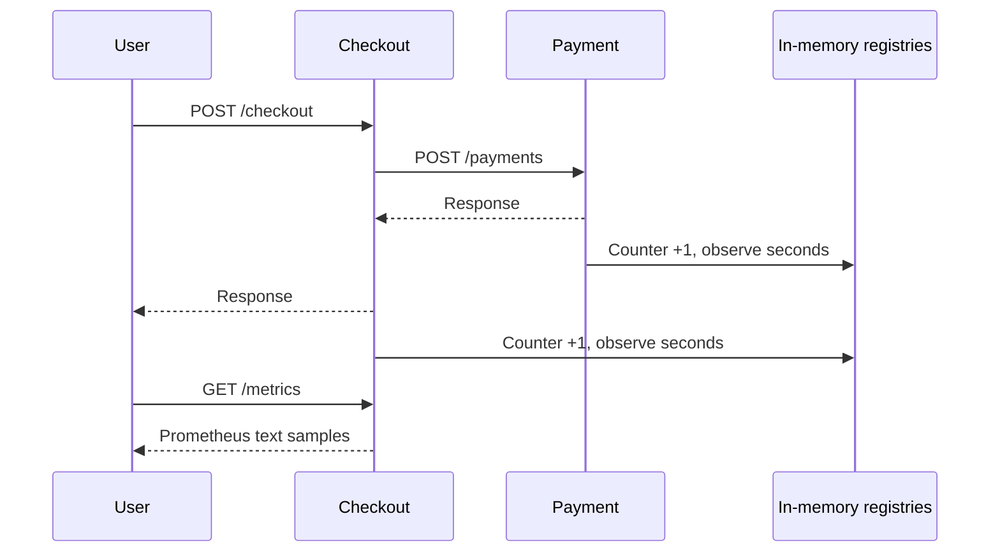

# P4 learning guide: observability and alert ingestion

## Scope and approval checkpoint

P1-P3 were reverified on 2026-10-17 before implementation. P4.1 was explained in
conversation, then the user explicitly selected Approve P4.1. This guide documents
P4.1 only. P4.2-P4.5 need their own explanation/approval checkpoints.

The phase roadmap is metrics (P4.1), Prometheus scraping/queries (P4.2), Loki log
collection (P4.3), cross-service tracing (P4.4), and authenticated/deduplicated alert
webhooks (P4.5). Instrumentation produces observations; it does not infer root cause,
run AI or authorize actions.

## P4.1 Concept

A log describes one request. A metric summarizes many requests. RED means request
Rate, Errors and Duration. This task records completed HTTP responses and their
durations. P4.2 will calculate rates/error ratios/percentiles over saved samples.

A counter increases by one for each completed response. A histogram observes one
duration in seconds. Its cumulative bucket with le=0.1 means requests completed
in at most 100 milliseconds; le=+Inf includes all observations. The histogram also
exports _count and _sum. Count must equal the corresponding request counter; sum
is total observed seconds, not a latency percentile. Approximate percentiles need
bucket history and a collector query, rather than dividing sum by count.

Labels distinguish a fixed service, bounded HTTP method, known route template and
status code. For example, checkout 201 and checkout 504 are different series. A
series is one unique combination of labels. Using arbitrary paths, IDs, email,
query strings or request IDs would let traffic create unbounded series. These
values belong in appropriately protected logs/traces, never these metric labels.
Unknown URLs share unmatched; unusual methods share OTHER. A status code records
validation errors as well as server failures. A later 5xx error-ratio query must
select the relevant codes and business route rather than treating every 4xx as a
service outage.

Prerequisites: running Node 24/npm 11, Python 3.11 virtualenv, existing checkout and
payment services, HTTP middleware understanding, and Docker Desktop for container
regressions. No new database, account, environment variable or migration is needed.

We use official Prometheus clients, rather than maintaining metric serialization
and bucket calculations ourselves. The current Node package is
@prometheus-io/client 0.16.1 (previously named prom-client); its declared Node engines
include 24. Python uses prometheus-client 0.26.0. Both versions are pinned.
Classic buckets keep this first cross-language implementation explicit and easy to
inspect; changing buckets later changes query resolution and requires care when
aggregating old/new series. Default process metrics are outside this small task.

## Architecture/data flow



Each app owns its own registry. A process restart resets its counters; the payment
and incident databases are unrelated to that registry. Later Prometheus scrapes
store history independently and can handle counter resets when calculating rates.

Node starts a monotonic performance timer before JSON parsing and records at the
response finish event. This includes validation and the awaited payment call.
Python starts its monotonic timer in the existing outer request middleware and
records after a final ASGI response body has been sent. It includes body validation,
async injected delay and database work delegated to a thread. Client disconnects
without a completed response are not counted by these completed-response metrics.
A completed checkout timeout and its later payment completion are separate service
observations and can have different statuses and durations.

GET /metrics exposes these two families from each service:

- sentinel_http_requests_total
- sentinel_http_request_duration_seconds, with _bucket, _count and _sum samples

The Python client also exports _created gauges with creation timestamps. These
are automatic metadata, not additional application request observations.

The histogram boundaries are 0.005, 0.01, 0.025, 0.05, 0.1, 0.25, 0.5, 1, 2.5, 5, 10 seconds,
plus the automatically generated +Inf bucket. Health/readiness requests count too;
later business queries should filter route=/checkout or route=/payments. Requests
to /metrics are excluded so scrapes do not inflate the application request rate.
Before a labeled combination has traffic, its sample can be absent; this is not
proof that a scrape failed. Look for HTTP 200 and HELP/TYPE metadata as well.

## File plan and implementation

| File                                                         | Change and reason                                                             |
| ------------------------------------------------------------ | ----------------------------------------------------------------------------- |
| services/checkout-service/src/metrics.ts                     | Per-app Registry, Counter, Histogram, bounded labels, observe/expose handlers |
| services/checkout-service/src/app.ts                         | Register timing before parsers and expose GET /metrics                        |
| services/checkout-service/test/metrics.test.ts               | Real Express metrics contracts with an explicitly labeled payment stub        |
| services/checkout-service/package.json and package-lock.json | Pin Node client and transitive dependencies                                   |
| services/payment-service/metrics.py                          | Per-app Python registry, observation function and exposition response         |
| services/payment-service/main.py                             | Construct registry, pass to middleware and register /metrics                  |
| services/payment-service/observability.py                    | Detect completed ASGI body and record final status/duration                   |
| services/payment-service/test_metrics.py                     | Real ASGI metrics, injected faults, bounded labels and isolation              |
| services/payment-service/requirements.in and .txt            | Direct dependency intent and resolved version                                 |
| scripts/verify-p1.py                                         | Verify actual metrics across the existing real two-service fault scenarios    |
| README.md, docs/PROGRESS.md and this guide                   | Run instructions, evidence, limitations and learning checkpoint               |

No schema changes. Existing REST response bodies and status rules remain the same.

## Walkthrough

createMetrics() returns observe and expose handlers. Its local registry prevents
separate app instances from sharing counts or throwing duplicate-registration
errors in tests. observe(req,res,next) skips scrapes, remembers a monotonic start,
adds a once-only finish listener, then calls next. The listener gets the resolved
allowlisted route, bounded method and final response status, increments the counter
and observes elapsed seconds. Malformed JSON before routing uses unmatched.
expose awaits registry.metrics() and returns the client's content type with
Cache-Control:no-store. It performs no database queries or network requests.

HttpMetrics.**init** builds a dedicated CollectorRegistry and the same metric
families/buckets. observe(method,route,status,seconds) converts unknown method/route
to bounded fallback labels, then updates counter and histogram. response() uses
generate_latest and the official content type to produce the text response.

create_app constructs one HttpMetrics and passes it to RequestContext. That
middleware already bounded request bodies and recorded safe logs. send_with_id
tracks response start/status and marks completion only after a final body has
been sent. finally records the measurement only for completed, non-scrape HTTP
responses, then writes the existing log. Endpoint templates come from the matched
ASGI route, so an attacker-controlled raw path does not become a label. Oversize
bodies rejected before routing use unmatched. Non-HTTP ASGI scopes remain outside
this HTTP measurement.

verify_metrics(port,route,status) in the existing verifier fetches real /metrics,
parses it using the Python client's parser and checks request count >= 3, matching
histogram count/+Inf bucket, positive duration sum, absence of secret markers and
no counter changes from repeated scrapes. It runs against checkout in all seven
fault scenarios and payment whenever payment is present. The unavailable case
correctly has no payment metrics. No mocked metric values are inserted.

Security: labels do not contain bodies, credentials or IDs. Endpoints are available
without bearer authentication inside the existing loopback/private demo boundary,
so a private collector can scrape them. Do not expose them on a public ingress.
Registries are in memory and make no new database/secret permissions necessary.
One Uvicorn worker per service instance is the supported mode here. Multiple Python
workers need reviewed multiprocess metric collection; simply adding workers would
produce incomplete per-process scrapes. Hosted replicas should each be scraped.

## Run/test

PowerShell, from V:\sentinel\sentinel:

```powershell
npm ci
.venv\Scripts\python.exe -m pip install -r services/payment-service/requirements.txt
npm run test --workspace=@sentinel/checkout-service
.venv\Scripts\python.exe -m pytest services/payment-service -q
npm run verify:p1
npm run verify:p2:compose
```

Expected: Node and pytest suites report no failures; the P1 and P2 verifiers end
with PASS. Actual final results/counts appear in PROGRESS.md, not these expectations.

For a native, memory-only payment demo, use separate terminals:

```powershell
.venv\Scripts\python.exe -m uvicorn main:app --app-dir services/payment-service --host 127.0.0.1 --port 3002 --no-access-log
npm run start:checkout
```

The checkout build must exist (use npm run build first). Memory-only payment records
are simulated demo data and disappear on process restart. The container-based
PostgreSQL workflow from P2 remains available for durable payment testing.

```powershell
Invoke-WebRequest http://localhost:3001/health
Invoke-WebRequest http://localhost:3002/health
(Invoke-WebRequest http://localhost:3001/metrics).Content
(Invoke-WebRequest http://localhost:3002/metrics).Content
```

Positive tests send real valid requests and verify counter/count/bucket consistency.
Negative tests send invalid JSON/fields, oversize bodies, unknown URLs and injected
fault responses, then verify bounded error labels and no leaked IDs/query markers.
Node's focused dependency-latency test uses a payment HTTP stub; Python tests use
real ASGI with simulated payment semantics. The seven-scenario verifier runs actual
Node and Python servers, including normal, 503, latency, timeout and unavailable cases.

## Debug

- /metrics 404: rebuild/restart the service; an old process/container may still serve
  the previous code. Check the port and the correct service.
- No labeled samples: send traffic first. Two independent apps do not share counts.
- Counter suddenly smaller: the service restarted. Do not try to persist its
  registry in PostgreSQL; P4.2's collector is responsible for metric history.
- Counts include probes: filter the business route, not the whole service.
- Timeout at checkout but 201 at payment: the downstream request may complete after
  checkout gave up; inspect both durations and existing request-ID logs.
- Duplicate collector error after a modification: keep the registry scoped to the
  app instance and pass that registry to every collector.
- Huge exported output after changing labels: remove raw URL/ID dimensions and
  restart the affected development process. Never make query strings a label.

## Manual setup and hosted connection

No manual setup required for the checked local environment; dependency installation,
tests and localhost preview were handled in this task. A fresh clone needs the
install/start commands above. No new secret or database provisioning is needed.

Hosted deployment remains unperformed. Later choose providers and approve costs;
deploy services on a private network, expose /metrics only to the collector, scrape
each service instance, provision durable metric storage/retention and configure
collector authentication/TLS where the network requires it. Do not rely on a
laptop process for public reliability data. Prometheus itself is added in P4.2;
Loki, trace storage and Alertmanager remain later approved tasks.

## Understanding check

1. Why is a request ID useful in logs but harmful as a metric label?
2. What does the +Inf bucket tell you, and why is _sum/_count not p95?
3. Why can checkout record 504 while payment records 201 for the same request?

Independent exercise: add a 0.2-second bucket to both services, send delayed payment
traffic and explain which cumulative bucket counts change. Re-run tests and do not
change metric names or label definitions. Student explanations/exercise are pending.

## Commit summary

The implementation commit is feat(P4.1): instrument checkout and payment HTTP metrics.
The configured Git account is the sole author, with no co-author trailer. P4.2
requires its own explanation and approval before implementation.

## References

- [Prometheus metric types](https://prometheus.io/docs/concepts/metric_types/)
- [Prometheus naming and label guidance](https://prometheus.io/docs/practices/naming/)
- [Official Node client](https://github.com/prometheus/client_js)
- [Official Python histogram documentation](https://prometheus.github.io/client_python/instrumenting/histogram/)
