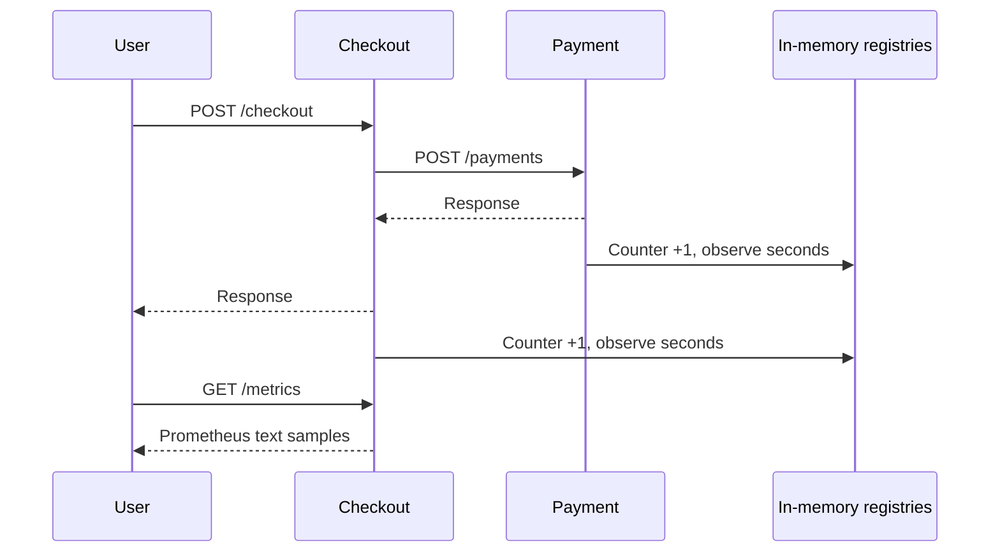

# P4 learning guide: observability and alert ingestion

## Scope and approval checkpoint

P1-P3 were reverified on 2026-10-17 before implementation. P4.1 was explained in
conversation, then the user explicitly selected Approve P4.1. This guide documents
P4.1-P4.5. After the remaining plan was explained, the user approved P4.2-P4.5
together. P5 requires a separate approval.

The phase roadmap is metrics (P4.1), Prometheus scraping/queries (P4.2), Loki log
collection (P4.3), cross-service tracing (P4.4), and authenticated/deduplicated alert
webhooks (P4.5). Instrumentation produces observations; it does not infer root cause,
run AI or authorize actions.

## P4.1 Concept

A log describes one request. A metric summarizes many requests. RED means request
Rate, Errors and Duration. This task records completed HTTP responses and their
durations. P4.2 will calculate rates/error ratios/percentiles over saved samples.

A counter increases by one for each completed response. A histogram observes one
duration in seconds. Its cumulative bucket with le=0.1 means requests completed
in at most 100 milliseconds; le=+Inf includes all observations. The histogram also
exports _count and _sum. Count must equal the corresponding request counter; sum
is total observed seconds, not a latency percentile. Approximate percentiles need
bucket history and a collector query, rather than dividing sum by count.

Labels distinguish a fixed service, bounded HTTP method, known route template and
status code. For example, checkout 201 and checkout 504 are different series. A
series is one unique combination of labels. Using arbitrary paths, IDs, email,
query strings or request IDs would let traffic create unbounded series. These
values belong in appropriately protected logs/traces, never these metric labels.
Unknown URLs share unmatched; unusual methods share OTHER. A status code records
validation errors as well as server failures. A later 5xx error-ratio query must
select the relevant codes and business route rather than treating every 4xx as a
service outage.

Prerequisites: running Node 24/npm 11, Python 3.11 virtualenv, existing checkout and
payment services, HTTP middleware understanding, and Docker Desktop for container
regressions. No new database, account, environment variable or migration is needed.

We use official Prometheus clients, rather than maintaining metric serialization
and bucket calculations ourselves. The current Node package is
@prometheus-io/client 0.16.1 (previously named prom-client); its declared Node engines
include 24. Python uses prometheus-client 0.26.0. Both versions are pinned.
Classic buckets keep this first cross-language implementation explicit and easy to
inspect; changing buckets later changes query resolution and requires care when
aggregating old/new series. Default process metrics are outside this small task.

## Architecture/data flow



Each app owns its own registry. A process restart resets its counters; the payment
and incident databases are unrelated to that registry. Later Prometheus scrapes
store history independently and can handle counter resets when calculating rates.

Node starts a monotonic performance timer before JSON parsing and records at the
response finish event. This includes validation and the awaited payment call.
Python starts its monotonic timer in the existing outer request middleware and
records after a final ASGI response body has been sent. It includes body validation,
async injected delay and database work delegated to a thread. Client disconnects
without a completed response are not counted by these completed-response metrics.
A completed checkout timeout and its later payment completion are separate service
observations and can have different statuses and durations.

GET /metrics exposes these two families from each service:

- sentinel_http_requests_total
- sentinel_http_request_duration_seconds, with _bucket, _count and _sum samples

The Python client also exports _created gauges with creation timestamps. These
are automatic metadata, not additional application request observations.

The histogram boundaries are 0.005, 0.01, 0.025, 0.05, 0.1, 0.25, 0.5, 1, 2.5, 5, 10 seconds,
plus the automatically generated +Inf bucket. Health/readiness requests count too;
later business queries should filter route=/checkout or route=/payments. Requests
to /metrics are excluded so scrapes do not inflate the application request rate.
Before a labeled combination has traffic, its sample can be absent; this is not
proof that a scrape failed. Look for HTTP 200 and HELP/TYPE metadata as well.

## File plan and implementation

| File                                                         | Change and reason                                                             |
| ------------------------------------------------------------ | ----------------------------------------------------------------------------- |
| services/checkout-service/src/metrics.ts                     | Per-app Registry, Counter, Histogram, bounded labels, observe/expose handlers |
| services/checkout-service/src/app.ts                         | Register timing before parsers and expose GET /metrics                        |
| services/checkout-service/test/metrics.test.ts               | Real Express metrics contracts with an explicitly labeled payment stub        |
| services/checkout-service/package.json and package-lock.json | Pin Node client and transitive dependencies                                   |
| services/payment-service/metrics.py                          | Per-app Python registry, observation function and exposition response         |
| services/payment-service/main.py                             | Construct registry, pass to middleware and register /metrics                  |
| services/payment-service/observability.py                    | Detect completed ASGI body and record final status/duration                   |
| services/payment-service/test_metrics.py                     | Real ASGI metrics, injected faults, bounded labels and isolation              |
| services/payment-service/requirements.in and .txt            | Direct dependency intent and resolved version                                 |
| scripts/verify-p1.py                                         | Verify actual metrics across the existing real two-service fault scenarios    |
| README.md, docs/PROGRESS.md and this guide                   | Run instructions, evidence, limitations and learning checkpoint               |

No schema changes. Existing REST response bodies and status rules remain the same.

## Walkthrough

createMetrics() returns observe and expose handlers. Its local registry prevents
separate app instances from sharing counts or throwing duplicate-registration
errors in tests. observe(req,res,next) skips scrapes, remembers a monotonic start,
adds a once-only finish listener, then calls next. The listener gets the resolved
allowlisted route, bounded method and final response status, increments the counter
and observes elapsed seconds. Malformed JSON before routing uses unmatched.
expose awaits registry.metrics() and returns the client's content type with
Cache-Control:no-store. It performs no database queries or network requests.

HttpMetrics.**init** builds a dedicated CollectorRegistry and the same metric
families/buckets. observe(method,route,status,seconds) converts unknown method/route
to bounded fallback labels, then updates counter and histogram. response() uses
generate_latest and the official content type to produce the text response.

create_app constructs one HttpMetrics and passes it to RequestContext. That
middleware already bounded request bodies and recorded safe logs. send_with_id
tracks response start/status and marks completion only after a final body has
been sent. finally records the measurement only for completed, non-scrape HTTP
responses, then writes the existing log. Endpoint templates come from the matched
ASGI route, so an attacker-controlled raw path does not become a label. Oversize
bodies rejected before routing use unmatched. Non-HTTP ASGI scopes remain outside
this HTTP measurement.

verify_metrics(port,route,status) in the existing verifier fetches real /metrics,
parses it using the Python client's parser and checks request count >= 3, matching
histogram count/+Inf bucket, positive duration sum, absence of secret markers and
no counter changes from repeated scrapes. It runs against checkout in all seven
fault scenarios and payment whenever payment is present. The unavailable case
correctly has no payment metrics. No mocked metric values are inserted.

Security: labels do not contain bodies, credentials or IDs. Endpoints are available
without bearer authentication inside the existing loopback/private demo boundary,
so a private collector can scrape them. Do not expose them on a public ingress.
Registries are in memory and make no new database/secret permissions necessary.
One Uvicorn worker per service instance is the supported mode here. Multiple Python
workers need reviewed multiprocess metric collection; simply adding workers would
produce incomplete per-process scrapes. Hosted replicas should each be scraped.

## Run/test

PowerShell, from V:\sentinel\sentinel:

```powershell
npm ci
.venv\Scripts\python.exe -m pip install -r services/payment-service/requirements.txt
npm run test --workspace=@sentinel/checkout-service
.venv\Scripts\python.exe -m pytest services/payment-service -q
npm run verify:p1
npm run verify:p2:compose
```

Expected: Node and pytest suites report no failures; the P1 and P2 verifiers end
with PASS. Actual final results/counts appear in PROGRESS.md, not these expectations.

For a native, memory-only payment demo, use separate terminals:

```powershell
.venv\Scripts\python.exe -m uvicorn main:app --app-dir services/payment-service --host 127.0.0.1 --port 3002 --no-access-log
npm run start:checkout
```

The checkout build must exist (use npm run build first). Memory-only payment records
are simulated demo data and disappear on process restart. The container-based
PostgreSQL workflow from P2 remains available for durable payment testing.

```powershell
Invoke-WebRequest http://localhost:3001/health
Invoke-WebRequest http://localhost:3002/health
(Invoke-WebRequest http://localhost:3001/metrics).Content
(Invoke-WebRequest http://localhost:3002/metrics).Content
```

Positive tests send real valid requests and verify counter/count/bucket consistency.
Negative tests send invalid JSON/fields, oversize bodies, unknown URLs and injected
fault responses, then verify bounded error labels and no leaked IDs/query markers.
Node's focused dependency-latency test uses a payment HTTP stub; Python tests use
real ASGI with simulated payment semantics. The seven-scenario verifier runs actual
Node and Python servers, including normal, 503, latency, timeout and unavailable cases.

## Debug

- /metrics 404: rebuild/restart the service; an old process/container may still serve
  the previous code. Check the port and the correct service.
- No labeled samples: send traffic first. Two independent apps do not share counts.
- Counter suddenly smaller: the service restarted. Do not try to persist its
  registry in PostgreSQL; P4.2's collector is responsible for metric history.
- Counts include probes: filter the business route, not the whole service.
- Timeout at checkout but 201 at payment: the downstream request may complete after
  checkout gave up; inspect both durations and existing request-ID logs.
- Duplicate collector error after a modification: keep the registry scoped to the
  app instance and pass that registry to every collector.
- Huge exported output after changing labels: remove raw URL/ID dimensions and
  restart the affected development process. Never make query strings a label.

## Manual setup and hosted connection

No manual setup required for the checked local environment; dependency installation,
tests and localhost preview were handled in this task. A fresh clone needs the
install/start commands above. No new secret or database provisioning is needed.

Hosted deployment remains unperformed. Later choose providers and approve costs;
deploy services on a private network, expose /metrics only to the collector, scrape
each service instance, provision durable metric storage/retention and configure
collector authentication/TLS where the network requires it. Do not rely on a
laptop process for public reliability data. Prometheus itself is added in P4.2;
Loki, trace storage and Alertmanager remain later approved tasks.

## Understanding check

1. Why is a request ID useful in logs but harmful as a metric label?
2. What does the +Inf bucket tell you, and why is _sum/_count not p95?
3. Why can checkout record 504 while payment records 201 for the same request?

Independent exercise: add a 0.2-second bucket to both services, send delayed payment
traffic and explain which cumulative bucket counts change. Re-run tests and do not
change metric names or label definitions. Student explanations/exercise are pending.

## Commit summary

The implementation commit is feat(P4.1): instrument checkout and payment HTTP metrics.
The configured Git account is the sole author, with no co-author trailer. P4.2
requires its own explanation and approval before implementation.

## References

- [Prometheus metric types](https://prometheus.io/docs/concepts/metric_types/)
- [Prometheus naming and label guidance](https://prometheus.io/docs/practices/naming/)
- [Official Node client](https://github.com/prometheus/client_js)
- [Official Python histogram documentation](https://prometheus.github.io/client_python/instrumenting/histogram/)

## P4.2 � Prometheus scraping and PromQL

### Concept and prerequisites

Approval: user approved the explained P4.2-P4.5 plan together. Docker Desktop,
Node/Python dependencies and P4.1 metrics are prerequisites. Prometheus polls
(scrapes) service endpoints and stores timestamped samples. PromQL queries those
samples: rate handles counter resets, an error fraction compares 5xx to total,
and histogram_quantile estimates a percentile from cumulative buckets. A percentile
is approximate; no samples or insufficient history can produce an empty result/NaN.

### Architecture/data flow and file plan

The local supervisor owns native checkout/payment processes. Prometheus in Docker
reaches their loopback endpoints through Docker Desktop's host.docker.internal.
This host bridge is development plumbing, not the hosted architecture. In a hosted
private network use internal service DNS and scrape every instance.

- infrastructure/compose.observability.yaml pins Prometheus by release and digest,
  publishes 9090 only on 127.0.0.1, uses a named volume and 512 MiB/one-CPU bound.
- infrastructure/observability/prometheus.yaml sets a 2-second scrape/evaluation
  interval and 1-second scrape timeout. These short values make the local lesson
  quick; choose slower intervals/budgets for hosted operation.
- infrastructure/observability/queries.promql explains availability, request rate,
  error fraction and p95 with business-route filters.
- scripts/observability_support.py provides bounded HTTP helpers, query polling and
  a Demo context manager that starts/stops only its own processes. It refuses busy
  ports, uses explicitly simulated memory-only payments, and strips Sentinel secrets
  from demo child environments. Exceptions and context exit stop owned children.
- scripts/observability-local.py supervises a continuing local preview. It stops at
  a 20 MB-per-file log budget. Ctrl+C stops owned apps; collectors/volumes remain.
- scripts/verify-p4.py runs real collector gates and writes ignored JSON evidence.

### Implementation and walkthrough

compose builds an argument list for the one fixed observability Compose file; it
never executes shell text. run uses subprocess with a bounded deadline. http
accepts only a local port/path, bounds response reads and HTTP time, and returns
status plus parsedJSON/text. wait retries a condition for at most 60 seconds.
query wraps Prometheus's read-only instant-query API and checks HTTP 200.
Demo.payment terminates only its owned payment child before selecting an allowlisted
fault mode and starting a replacement. Application registries reset across that
restart; Prometheus history persists independently. The verifier creates real normal
traffic, switches its own payment child to the simulated error mode and measures
nonzero checkout 5xx rate. It also tests invalid PromQL and restarts only Prometheus,
then reads the earlier sample at its original timestamp.

Storage is bounded by 24-hour retention and 256 MB target retention, with disk/WAL
and head-block overhead possible. The memory/process limits are separate. The
local UI has no public ingress/authentication: never publish these ports publicly.
Metrics are evidence, not authorization to remediate. No database migration is added.

### Run/test and debugging

```powershell
.venv\Scripts\python.exe scripts/verify-p4.py --task P4.2
.venv\Scripts\python.exe scripts/observability-local.py
```

Expected verifier output: PASS: P4.2 real collector verification. Actual results
are recorded in PROGRESS.md and .artifacts/observability/p4.2-verification.json.
Open http://localhost:9090/query and paste expressions from queries.promql. A
positive check finds two up=1 targets and saved counters; the negative test sends
malformed PromQL and expects 400/422. The fault check uses real HTTP502/503 from
injected demo faults, not invented metric samples. Empty rate needs at least two
scrapes; wait several seconds. up=0 usually means the app stopped, wrong port or
Docker host bridge failure. A busy3001/3002 is deliberately rejected; stop the
existing demo you own rather than killing arbitrary listeners. Use Compose down
without -v when intentionally stopping collectors; never delete volumes to debug.

### Manual setup, understanding check and commit summary

No manual setup required for this verified Windows environment beyond running
Docker Desktop. A fresh clone installs pinned dependencies/builds checkout and
runs the commands above. Hosted setup remains unperformed: choose/approve a metric
provider or host, persistent disks/retention, private target DNS, scrape identities,
TLS/authentication and per-replica discovery. Local Docker Desktop DNS is not a
hosted dependency or database replacement.

Questions: Why use rate rather than counter subtraction? What does up=0 prove and
what does it not prove? Why retain the le label while aggregating histogram buckets?
Exercise: change the displayed PromQL window from 1m to 2m and explain the tradeoff
between responsiveness and smoothing. Learner responses/exercise remain pending.
Commit: feat(P4.2): collect and verify Prometheus service metrics.

## P4.3 � JSON logs through Alloy into Loki

### Concept, prerequisites and approval

Approved with the combined P4 plan. P4.2 provides the running demo and collector
network. Logs describe individual events; Loki indexes a deliberately small set
of stream labels, then LogQL parses the JSON fields during a query. Request IDs
remain JSON fields rather than labels, preventing one indexed stream per request.
Alloy is the supported collector used here. The applications still write their
existing allowlisted JSON completion/fault records; no log content authorizes tools.

### Architecture/data flow and file plan

The owned supervisor redirects each demo process's stdout/stderr to its own log
file under ignored .artifacts/observability/logs. Alloy mounts only that directory
read-only, not the Docker socket or the rest of the workspace. It tails checkout.log
and payment.log, drops malformed non-JSON startup lines, reads timestamp using
RFC3339Nano, then sends records to Loki over the private Compose network. Service
is a fixed stream label; arbitrary JSON fields are not promoted to labels.

Files: compose.observability.yaml adds release/digest-pinned Loki 3.7.8 and
Alloy 1.20.1, resource limits and named data/positions volumes; loki.yaml configures
single-node filesystem/TSDB storage with 24h retention; config.alloy defines exactly
two file sources, timestamp processing and the Loki writer; verify-p4.py adds real
LogQL and negative-query checks. Existing P4.2 supervisor supplies the files.

### Implementation and walkthrough

loki.source.file remembers read positions in the persistent Alloy storage volume.
loki.process parses only timestamp/event into temporary fields, preserving the raw
JSON for query-time inspection. stage.timestamp uses the application's UTC event
time, rather than pretending collection time is occurrence time. Invalid timestamps
are not fabricated; failure skips timestamp conversion and uses collector handling.
loki.write batches delivery to the fixed private Loki endpoint. Loki's named volume
retains chunks/indexes and compactor state; the in-memory ring is single-node
membership metadata rather than the only log store. Loki disables anonymous usage
reporting. Local API publication is127.0.0.1:3100 with no public ingress.

The verifier switches its owned payment process to 2.5-second latency while checkout's
1-second deadline is active. A real checkout 504 completion log receives a unique
request ID. It polls LogQL for that exact ID and status, so old logs cannot satisfy
the test. It checks that Loki index labels do not include request_id and malformed
LogQL returns 400/422. Loki ingestion is asynchronous; bounded polling accounts for
collector batching/startup. HTTP deadlines and a 90-second query gate prevent hanging.

### Run/test and debugging

```powershell
.venv\Scripts\python.exe scripts/verify-p4.py --task P4.3
```

Expected PASS: P4.3 real collector verification; actual evidence is in PROGRESS.md
and ignored .artifacts/observability/p4.3-verification.json. Example LogQL:

```logql
{service="checkout-service"} | json | status=504
```

If empty, generate a timeout, inspect the two mounted log files, confirm Alloy is
running and wait for its batch. Never index arbitrary URLs or request IDs to make
queries easier. Mixed uvicorn startup lines are intentionally dropped. Collection
of already-written data can replay after lost positions; query duplicate events
using their request/event fields if needed. Local log files stop the supervisor at
20MB each; this is a demo bound rather than a production rotation policy.

### Manual setup, understanding and commit

No additional manual setup required locally. Hosted work remains unperformed:
choose/approve Loki storage and retention, scoped collector identities/file access,
rotation/replay policy, encryption, tenant authentication and private networking.
Do not expose this unauthenticated single-tenant Loki configuration publicly.

Questions: Why query request_id as JSON rather than an index label? Why distinguish
event timestamp from ingestion time? What happens when the collector is behind?
Exercise: add a LogQL filter for level=error and explain why it can differ from a
fault_injected warning. Student understanding/exercise remain pending.
Commit: feat(P4.3): collect demo JSON logs with Alloy and Loki.

## P4.4 � Cross-language OpenTelemetry traces

### Concept, prerequisites, architecture and approval

Approved with the combined P4 plan. A trace groups operations by trace ID. A span
has its own span ID, start/end times and optional parent. Here the flow is checkout
SERVER -> payment-call CLIENT -> payment SERVER. Separate spans explain where time
was spent; a trace still does not establish the ultimate cause of a failure.
W3C traceparent carries IDs across the HTTP hop. Baggage is arbitrary metadata and
is deliberately not forwarded. Existing request IDs remain useful log correlations.

### File plan and implementation

- Checkout tracing.ts builds an optional SDK provider and bounded batch exporter,
  request middleware, client child-span helper and traceparent injection. app.ts
  mounts it before request logging; payment-client.ts ends a span for each attempt;
  http.ts adds the active trace ID to the already allowlisted completion log.
- Payment tracing.py builds its own provider/exporter and extracts only a bounded
  traceparent header. RequestContext creates/ends the receiving span and adds its
  trace ID to completion logs. The SDK validates malformed context into a fresh root.
- Node SDK 2.12.0, OTLP HTTP exporter 0.223.0 and their direct dependencies are pinned.
  Python SDK/exporter 1.45.1 and resolved transitive dependencies are pinned.
- Tempo 3.1.0 is release/digest pinned in Compose, with private OTLP HTTP receive
  port 4318 mapped only to 127.0.0.1:4418 and query API 127.0.0.1:3200. A named volume
  stores local trace blocks/WAL; backend_worker retention is24h. Tempo 3's monolithic
  deployment needs no Kafka. Metrics/log collectors remain independent.
- Focused tracing tests cover bounded configuration and context behavior;
  verify-p4.py adds connected-trace and actual backend-outage checks.

### Walkthrough

tracing() returns no-op middleware when the export endpoint is absent. When enabled,
it validates the fixed local receiver URL, creates a service-named resource and
BatchSpanProcessor. Each provider has a 256-span queue, 64-span batches, 500 ms flush
interval and bounded export deadlines. The middleware starts a fresh ingress root
rather than trusting public trace headers. It sets x-trace-id for local inspection,
ends once on finish/close and marks server failures/disconnects as errors.
clientSpan builds an explicit child context rather than relying on global async
instrumentation. traceHeaders serializes its SDK-generated IDs. payOnce records
status, marks thrown failures, ends in finally, and preserves existing bounded
HTTP calls and retries. A retry gets a new child span, not another payment identity.

Python create_tracer similarly validates the endpoint and creates a service-named,
bounded batch exporter. server_span accepts only traceparent(up to 128 bytes), never
baggage. RequestContext ends the span with final HTTP status and logs only its trace
ID. Tracing changes neither database transactions nor payment response contracts.
No global SDK registration is required for these explicit spans, avoiding ESM
loader/automatic-instrumentation ordering surprises. This is deliberately narrower
than instrumenting every library. SDK batch delivery can drop telemetry during an
outage; it must not prevent a business response or claim complete trace coverage.

### Run/test, negative paths and debug

```powershell
npm run test --workspace=@sentinel/checkout-service
.venv\Scripts\python.exe -m pytest services/payment-service -q
.venv\Scripts\python.exe scripts/verify-p4.py --task P4.4
```

The supervisor sets OTEL_EXPORTER_OTLP_TRACES_ENDPOINT to the fixed local receiver.
The verifier reads x-trace-id from an actual checkout, retrieves that trace from
Tempo and checks service identities, at least three spans and parent links. It
then stops only Tempo and confirms a real checkout still succeeds, before starting
Tempo again. Incoming malformed context is exercised; focused Python tests inspect
real SDK in-memory spans for valid/invalid parent IDs. No trace payload is fabricated.

If missing, check export configuration, receiver readiness, span end time and batch
flush delay. Query by exact trace ID before broad searches. Inspect service resource
names and parent IDs; three unrelated traces do not prove propagation. Requests
with exports disabled remain valid but produce no x-trace-id. Private endpoint
validation intentionally rejects remote/plaintext arbitrary destinations. Hosted
TLS export configuration needs a reviewed extension rather than bypassing this
local guard. No credentials/URLs/bodies are captured as span attributes.

### Manual setup, understanding and commit

No additional local manual setup required. Hosted setup remains unperformed:
choose/approve trace storage/retention, private authenticated TLS OTLP receivers,
sampling/cost budgets and service instance identity; configure exporters without
PII/baggage and verify propagation through the actual ingress. Local full sampling
is for bounded demo traffic, not an unrestricted production policy.

Questions: Why three spans rather than three trace IDs? Why can a payment trace
finish after checkout timed out? What telemetry can be lost while payments work?
Exercise: find one timeout trace and compare span duration with the corresponding
Loki completion log. Learner answers/exercise remain pending.
Commit: feat(P4.4): trace checkout to payment with OpenTelemetry and Tempo.

## P4.5 � Alerts, authenticated ingestion and incident deduplication

### Concept, prerequisites and approval checkpoint

Approved with the combined P4 plan, including a new migration. P4.1-P4.4 supply
telemetry; P3 supplies authenticated incidents, PostgreSQL transactions and events.
Prometheus evaluates a condition repeatedly. A for duration requires it to remain
true before FIRING; a resolved signal says that condition stopped holding. Alertmanager
groups related alerts and retries notifications. Delivery can repeat or arrive late,
so backend authorization and transaction-safe deduplication are essential.

### Architecture/data flow and file plan

A real checkout fault raises its5xx fraction above 25 percent with minimum traffic.
The local rule requires 6 seconds, then Alertmanager groups by alertname/service,
waits 2 seconds and posts to /api/v1/webhooks/alertmanager. The API verifies a distinct
Bearer key before parsing bounded JSON, validates the allowlisted alert and service,
then writes an episode receipt and incident/initial event atomically. Repeat delivery
returns the existing incident ID. Resolved signals update receipt metadata only.

Files: alerts.yaml contains the sustained-error rule; prometheus.yaml discovers
Alertmanager and loads that rule; alertmanager.yaml defines grouping/retries and a
read-only credentials file; Compose adds pinned/digest Alertmanager 0.34.1 with named
storage, private 9093 and limits. Migration005_alert_episodes.sql adds receipts/episode
uniqueness. alert-ingestion.ts owns validation, authentication, transactional storage
and HTTP routing. app.ts mounts it before ordinary JWT routes because this receiver
uses a separate identity; server.ts enables it only with valid configuration.
api-local.py generates/preserves a distinct ignored key and removes it from worker
environments. .env.example includes a fake placeholder only. Focused parser/HTTP/
database tests and verify-p4.py exercise negative paths and actual alert delivery.

### Implementation and walkthrough

readWebhookSecret accepts an optional 64-hex configuration value; malformed supplied
values fail startup. Missing configuration makes the receiver unavailable rather
than anonymous. The route compares equal-length credential bytes in constant time,
requires JSON and limits bodies to 64 KiB. At most two ingest operations per API
process run concurrently; busy requests receive retryable503. Ordinary API reads
still require their user JWT; possession of the webhook key grants no other API role.

parseAlert accepts Alertmanager version 4, receiver sentinel, at most 20 complete
alerts, only CheckoutHighErrorRate/checkout-service and matching group/individual
labels. Truncated batches are rejected. Starts must be within 30 days and no more than
5minutes in the future; resolved ends must follow starts and be no more than 5 minutes
ahead. Status must match the member signals. Sender groupKey, annotations, arbitrary
external URLs and additional labels never select commands, SQL, fetch targets or
incident titles. Only validated canonical values reach storage.

The episode key hashes the service, allowlisted alert name and earliest canonical
start timestamp in this grouped notification. This shipped rule aggregates to one
service-level alert, keeping group membership/start stable. Broad multi-instance
rules need a reviewed episode/group lifecycle contract before enabling them.
PostgreSQL advisory transaction locks serialize a canonical episode across API
instances, supplemented by primary/unique constraints. A first firing inserts
incident severity HIGH/title fixed by backend, its CREATED event and receipt in one
transaction. Any failure rolls everything back and returns sanitized503. Repeats
increment a capped count and reuse the incident. Resolved is terminal for that
signal episode; late firing repeats cannot resurrect it. Resolved-first notification
records a receipt with no invented incident. A later independent episode has a new
start and can create a new incident. Incident status stays under the established
human/operator workflow; no alert executes remediation or automatically resolves it.

The helper writes the credential to ignored .env.api. observability_support copies
only that specific validated key into an ignored local credential file mounted
read-only into Alertmanager. It never prints it. Local URLs are fixed. The supervisor
still strips Sentinel secrets from demo services. Authenticated webhook retries and
saved receipt uniqueness survive API restart because the database owns the record.

### Run/test and debug

```powershell
.venv\Scripts\python.exe scripts/api-local.py
# Another terminal; demo ports 3001/3002 must be free:
.venv\Scripts\python.exe scripts/verify-p4.py --task P4.5
```

Expected final PASS is not itself evidence until recorded in PROGRESS.md. The live
verifier deliberately produces simulated local failures and creates a real demo
incident in the existing local Sentinel database. It waits for earlier fault samples
to leave the short rule window, records the baseline, sustains a new fault, verifies
exactly one new grouped incident and repeated deliveries, then restores normal
traffic and verifies signal recovery without incident auto-resolution. All P4
metric/log/trace gates run as part of this task. API database tests separately cover
concurrent delivery, resolved-first/late firing, forced event rollback, absent/wrong
credentials, unsupported/truncated/malformed payloads and public API role separation.

The local rule uses 30-second rate windows, 6-second persistence and 10-second repeat
notifications for a short lesson. These are demonstration thresholds, not validated
production SLOs. The traffic guard avoids alerting on a single very sparse sample;
missing data is not treated as healthy and target-up alerting is a separate future
rule. Before changing rules, validate configuration with promtool; do not expose an
unbounded rule/query API to telemetry or users.

401 means the distinct webhook credential is absent/wrong; never paste it into chat.
503 can mean missing configuration/schema, storage outage or the bounded ingest
budget; inspect readiness and safe logs, then retry.422 means invalid/unsupported
notification; do not loosen validation to accept arbitrary alerts. If no live
incident, inspect Prometheus rule state, then Alertmanager receiver delivery, then
API status, then receipt/incident persistence in that order. A successful synthetic
HTTP post alone does not prove the real alert chain. Stop test faults using the
owned supervisor, never arbitrary production remediation.

### Manual setup, understanding and commit summary

No additional local manual setup required after the checked helpers run. The helper
generates the separate key; existing user credentials/accounts are preserved. No
provider account, paid service or external deployment was created. Hosted setup
remains unperformed: provision private collectors and durable storage, configure
reviewed SLO thresholds/traffic guards, put a rotated webhook secret in the API
secret manager and Alertmanager credential store, use authenticatedTLS between
hosts, scoped ingress/rate limits and migration identity, then verify a sandbox
alert all the way to the hosted database and browser stream. This local plaintext
host bridge must not be copied onto a public network.

Questions: Why must deduplication live in PostgreSQL rather than Alertmanager alone?
Why does signal recovery not prove an incident is resolved? Which fields from an
untrusted notification are allowed to select an action(none)? Exercise: compare one
alert episode's notification count with its single incident and initial event;
explain why retries changed one number but not the others. Learner mastery remains
pending your independent answers/exercise.
Commit: feat(P4.5): ingest authenticated grouped alerts without duplicate incidents.
P4 software acceptance is complete only after the recorded checks pass. P5 is not
approved by the instruction to finish P4.
